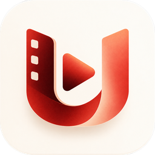
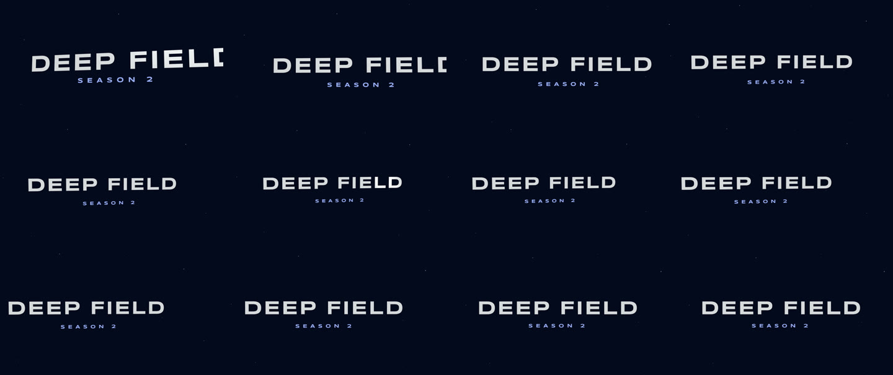
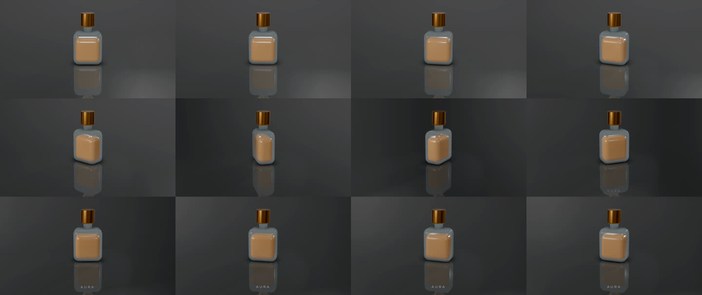
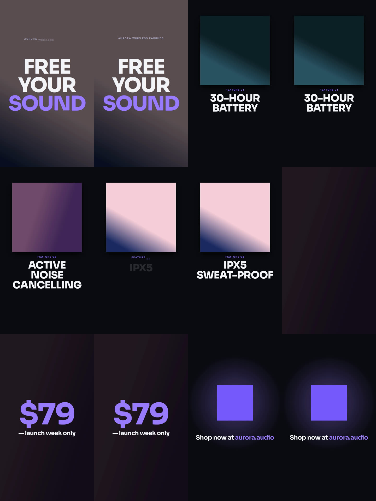
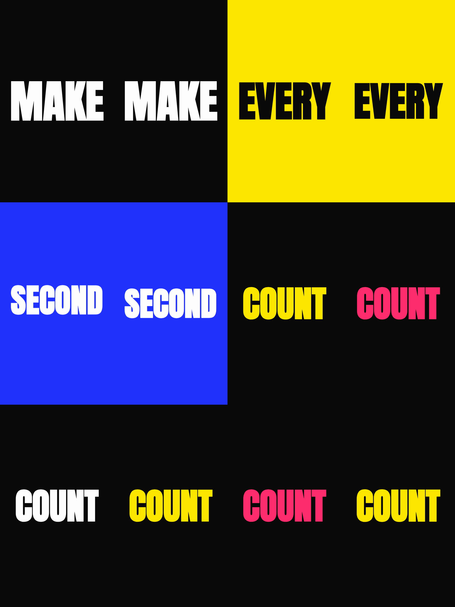

<div align="center">



# Ultimate Video Editor

**A real desktop motion editor that an AI agent can drive end to end — and that you can still finish by hand.**

[](apps/desktop)
[](packages)
[](#drive-it-from-an-agent)
[](#voice-and-indian-languages)
[](https://github.com/RudraO2/ultimate-video-editor/actions/workflows/ci.yml)
[](#tests-and-quality)
[](LICENSE)
[](CONTRIBUTING.md)

[Features](#features) • [Quick Start](#quick-start) • [Drive it from an agent](#drive-it-from-an-agent) • [Architecture](#architecture) • [Tech Stack](#tech-stack) • [Benchmarks](#what-agents-actually-build) • [Team](#team)

*Say it in Hindi. Get it cut, captioned in Devanagari, and released in Tamil in your own voice.*

</div>

Ultimate Video Editor (UVE) is a document-driven motion and video editor — multi-track timeline,
keyframes on every property, effects, kinetic type, 3D worlds, physics, a real mixer — where
**every single thing the UI can do is also a command**, and every command is automatically an
agent tool over MCP. An agent doesn't write video code or shell out to ffmpeg: it edits the same
document you do, one undoable step at a time, and you can take the project over mid-sentence.

> Type or speak **"इसे साफ़ करो, कैप्शन लगाओ, और तमिल में मेरी आवाज़ में बना दो"** into the chat.
> The clip gets cut (pauses, "matlab", false starts, each cut marked with its reason), captioned in
> Devanagari, and re-released in Tamil in the speaker's own cloned voice — about **47 s** the first
> time, **28 s** warm, for roughly **₹3.40**.

Agents reach it through MCP (Claude Code, Codex, Gemini CLI, Cursor, VS Code, Claude Desktop), or
through **OpenCode running inside the app**, so a non-technical user never leaves the editor.

## Contents

- [Why this is different](#why-this-is-different)
- [Features](#features)
- [Quick Start](#quick-start)
- [Drive it from an agent](#drive-it-from-an-agent)
- [Architecture](#architecture)
- [Tech Stack](#tech-stack)
- [Voice and Indian languages](#voice-and-indian-languages)
- [Cutting your own footage](#cutting-your-own-footage)
- [Screen recording](#screen-recording)
- [3D worlds](#3d-worlds)
- [Sound that sounds finished](#sound-that-sounds-finished)
- [The asset library](#the-asset-library)
- [What agents actually build](#what-agents-actually-build)
- [Using the editor by hand](#using-the-editor-by-hand)
- [Tests and quality](#tests-and-quality)
- [Project layout](#project-layout)
- [Status and roadmap](#status-and-roadmap)
- [Research and licences](#research-and-licences)
- [Contributing](#contributing)
- [Team](#team)

## Why this is different

- **Not a wrapper around a render script.** The agent calls `layer_create`, `keyframes_set`,
  `animation_set`, `effects_add` — the editor's own API. The result is a project file a human can
  open, inspect and fix, not a black box that has to be regenerated from scratch.
- **One undo step per turn.** An agent's whole request collapses into a single history entry named
  after the app that made it (`Agent · Claude Code`). A failed command leaves the project exactly
  as it was and returns `{ok: false, error, hint}` — the hint says what to do instead.
- **Everything works by hand too.** Every tool has a panel, a drag, a shortcut. The editor is
  usable with the agent turned off.
- **Assets are the real bottleneck, so they ship with it.** 4,555 CC0 sounds, ~3,300 stickers,
  ~413,000 icons, 1,946 Google font families, 103 text looks, 44 animation presets, 38 effect
  cards, 23 transitions. An agent that can't find a whoosh makes a silent video.
- **Deterministic by design.** Physics needs no baking, scripts run with seeded `Math.random` and a
  frozen `Date`, and every frame is rendered exactly as the export renders it — preview and file
  match.

| | |
|---|---|
| **Agent tools over MCP** | 128 |
| **TypeScript** | ~89,000 lines across 4 packages |
| **Unit tests** | ~1,400 across 141 files, Vitest, no network |
| **Agent benchmark briefs** | 19, from a title card to a 117 s launch film |
| **Export formats** | 9 (MP4, MOV master, WebM, GIF, PNG sequence, PNG/JPG/WebP still, WAV) |

## Features

- **Agent-native, not agent-bolted-on.** Every registry command becomes an MCP tool automatically,
  under plain, guessable names (`layer_set`, `keyframes_set`, `api_batch`…). Each tool also accepts
  more than one spelling of the same input, so an agent that writes a reasonable shape gets an
  answer instead of a rejection.
- **Kinetic type with real per-unit motion.** 44 animation presets applied per letter, word or line,
  with stagger, delay, humanize, easing and a timing bar — not one layer per word.
- **The full 2D stack.** Text boxes with auto width/height and wrap, gradients and multiple fills and
  strokes, stroke trim (draw-on), paths, polygons, stars, masks, groups with auto layout, styled
  character ranges, nested comps and ripple edits.
- **38 effect cards.** Shadows, glows, outlines, blurs, shine, film grain and damage, distortions,
  colour, halftone, light rays, lightning, liquid glass, per-letter text effects — plus motion blur.
- **Seamless 2D ↔ 3D.** Move a layer or a whole frame into a 3D world without the picture changing
  by a pixel. 13 mesh primitives with keyable params, real extrusion with bevels, cameras, lights,
  17 materials, bloom, ambient occlusion, mirror floors, depth of field that follows a layer, and
  glTF/GLB/OBJ/STL/PLY model import with their own animation clips.
- **Physics that needs no baking.** Any picture, text, shape or group falls, bounces and collides on
  its true outline (stickers on their silhouettes, text on its letters). Wind, attract, vortex,
  turbulence, drag; pin, weld, rope and spring joints. Deterministic — preview equals export —
  and `physics_bake` turns it into editable keys when you want them.
- **Characters that are alive.** A drawn person or flat emoji placed as layers comes alive in one
  click: parts found by name or shape, eyes that blink together, a body that breathes, and a mouth
  set that talks in time with a voice line. Bones, IK, limits, pose on canvas.
- **Scripts in a sandbox.** JavaScript that drives the editor through its own commands
  (`await ac.layer.create({...})`) in QuickJS: no files, no network, no timers, seeded random,
  frozen clock. One run is one undo step; a failed run changes nothing.
- **A mixer, not volume sliders.** Sound categories (Dialogue, Music, Effects, Ambience), a leveler
  to per-category loudness targets, ducking that dips music 10 dB under dialogue just before the
  first word, loudness match to −14 LUFS and a −1 dB true-peak limiter. Preview and export mix
  identically, and every export reports its integrated loudness and true peak.
- **Voice-first, in Indian languages.** Speak to the editor in any language; get captions in your
  script and a whole comp re-released in another language, in your own cloned voice, re-timed.
- **It cuts your raw footage.** One pass reads a file (speech gate, every word, shot changes), then
  marks and removes pauses, fillers, false starts and retakes — each cut with a reason you can
  hover.
- **Screen recording with auto-zoom.** Record a display or a window with system audio, mic and
  webcam PiP; the real Windows cursor is captured exactly, and zooms are planted on your clicks as
  ordinary, editable scale and position keys.
- **Easy and Advanced modes.** Easy is chat + preview + a simple timeline for the person who just
  wants the video. Advanced is every panel. Same project, switch any time.
- **Offline-friendly.** Fonts, icons and the CC0 sound library are mirrored to disk after first use;
  media files stay where they are and are referenced by path.

## Quick Start

**Just want to use it?** Download the installer for your machine from
[**Releases**](https://github.com/RudraO2/ultimate-video-editor/releases/latest):

| | |
|---|---|
| **Windows** | `UltimateVideoEditor-<version>-win-x64.exe` — the usual installer. Screen recording works here. |
| **macOS** | `UltimateVideoEditor-<version>-mac-arm64.dmg` (Apple silicon) or `-mac-x64.dmg` (Intel). The build is **unsigned**, so the first launch needs right-click ▸ **Open** ▸ Open, or `xattr -dr com.apple.quarantine "/Applications/Ultimate Video Editor.app"`. |
| **Linux** | `.AppImage` (`chmod +x`, then run) or `.deb`. |

For the voice features, paste a [Sarvam](https://dashboard.sarvam.ai/) API key into the **Voice**
tab, or set `SARVAM_API_KEY` before launching. Everything else works without one.

### Build from source

You need **Node.js 22.12+** and **pnpm 10**.

```sh
pnpm install
pnpm dev
```

That's the whole setup for the editor. For voice, captions and translation, add a Sarvam key before
starting (paste it in the Voice tab, or set it in the environment):

```sh
# macOS / Linux
export SARVAM_API_KEY=...
pnpm dev
```

```powershell
# Windows PowerShell
$env:SARVAM_API_KEY = [Environment]::GetEnvironmentVariable('SARVAM_API_KEY','User'); pnpm dev
```

| Command | What it does |
| --- | --- |
| `pnpm dev` | Runs the desktop app in development. |
| `pnpm test` | Runs the unit tests (Vitest). |
| `pnpm typecheck` | Type-checks every package. |
| `pnpm build` | Builds the desktop app into `apps/desktop/out`. |
| `pnpm dist` | Builds an installer for the current OS into `apps/desktop/release` (electron-builder). |

<details>
<summary>Environment flags and gotchas</summary>

- If the Electron binary is missing after install, run `pnpm rebuild electron`.
- `UVE_MCP_PORT` — serve the agent API on another port (a busy port falls back to a free one).
- `UVE_REMOTE_DEBUG_PORT=9222` — let DevTools-based tools (for example the Chrome DevTools MCP
  server) inspect the window.
- `UVE_LOW_POWER_GPU=1` — stay on the integrated GPU to save battery. By default a dual-GPU laptop
  renders on the discrete one, which makes 3D worlds and their exports several times faster.
- `UVE_OPENCODE_PATH` — point at an existing OpenCode binary instead of the bundled lookup.
- Screen recording currently ships Windows capture helpers only.

</details>

## Drive it from an agent

While the editor is open it runs an MCP server on `http://127.0.0.1:7428/mcp`. Only this computer
can reach it, and every request needs the bearer token. The URL and token are written to
`~/.uve/mcp.json`.

**Recommended — the stdio shim** (`uve-mcp.mjs`, copied to the app's user-data folder). It re-reads
the URL and token on every start, so it keeps working when the port moves, and it answers
`uve_status` even while the editor is closed.

```sh
# Claude Code
claude mcp add -s user uve -- node "<user data>/uve-mcp.mjs"
```

```toml
# Codex — ~/.codex/config.toml
[mcp_servers.uve]
command = "node"
args = ['<user data>/uve-mcp.mjs']
default_tools_approval_mode = "approve"   # without it, codex exec refuses every call
```

The **Agents ▸ Connect your agent** dialog prints the exact command with the real path for Claude
Code, Codex, Gemini CLI, OpenCode, Cursor, VS Code and Claude Desktop. Apps that only take an HTTP
server use the URL with `Authorization: Bearer <token>`.

**OpenCode inside the app.** The Agents tab runs OpenCode (MIT) over the Agent Client Protocol as
the editor's own agent: its messages, thinking, tool calls with results, plan and questions stream
as they happen. It gets its own config folder and a copy of the skill, so your personal OpenCode
setup stays out of it. The agent is video-only by permission: editor tools, reading files and the
web are free; it cannot edit files; the shell runs media commands (`ffprobe`, `ffmpeg`, file moves)
and asks first for anything else.

**What the agent is taught.** The skill (`skill/`, served as MCP resources under `uve://skill/`)
gives it a loop — orient, plan a beat sheet, build in batches, *look at its own frames* with
`view_render` / `view_frames`, refine, do a sound pass, export, report — plus recipes, a design
system, storytelling notes, sound craft and a review checklist.

<details>
<summary>The tool surface at a glance</summary>

| Job | Tools |
| --- | --- |
| Read | `doc_overview`, `layers_list`, `layer_get`, `layer_properties`, `media_list`, `api_describe` |
| Build | `layer_create`, `layer_set`, `layer_patch`, `layers_duplicate/copy/restack/nest`, `api_batch` |
| Animate | `keyframes_set/remove/clear/inspect/simplify/smooth`, `animation_set`, `motion_edit`, `transition_add` |
| Look | `effects_add`, `effects_update`, `text_set`, `template_apply`, `catalog_list` |
| Time | `timeline_move/trim/split/close_gaps/compact/cut_ranges/insert_time/markers` |
| 3D | `world_create/inspect/move_into/add/camera/extrude/material/look/track/import_model` |
| Sound | `sounds_list`, `sounds_use`, `sound_category`, `caption_set` |
| Voice | `generate_speech`, `voices_list`, `media_transcribe`, `text_translate`, `comp_localize`, `sarvam_usage` |
| Footage | `media_analyze`, `media_inspect`, `media_describe_shots`, `media_remove_pauses`, `media_search`, `timeline_place_broll` |
| Screen | `screen_record`, `media_auto_zoom`, `screen_frame` |
| Life | `physics_scene/body/force/joint/inspect/bake`, `rig_create/bone/bind/pose/inspect`, `character_detect`, `character_bringToLife`, `behaviors_*` |
| Assets | `stickers_list/use`, `icons_list/use`, `svg_place`, `fonts_list`, `font_install`, `media_remove_background` |
| Script | `script_run/save/list/read/remove/runs/logs/stop` |
| Ship | `view_render`, `view_frames`, `export_video`, `project_save/open/new`, `history_undo`, `uve_status`, `report_issue` |

Layers are addressed by id or by a name only one layer has. `api_batch` runs up to 50 calls in
order, and later inputs can reference earlier results (`"$0.id"`).

</details>

## Architecture

```
  Claude Code · Codex · Gemini CLI · Cursor · VS Code          you, with a mouse
            │                                                         │
            │  MCP (stdio shim or Streamable HTTP + bearer token)     │
            ▼                                                         │
┌───────────────────────── Electron main process ─────────────────────┼──────────┐
│  MCP server (127.0.0.1:7428)   OpenCode host (ACP)                  │          │
│  uve-media:// file server      screen recorder (WGC + cursor)       │          │
│  Sarvam bridge (STT · TTS · translate, disk cache, spend ledger)    │          │
└───────────────────────── IPC: call / result + images ───────────────┼──────────┘
            │                                                         │
            ▼                                                         ▼
┌──────────────────────────── Renderer (React) ──────────────────────────────────┐
│  Editor UI — viewport · timeline · inspector · library · chat                   │
│                              │                                                  │
│  Command registry  ◄─────────┘   zod-strict inputs, undo transactions,          │
│  (packages/core)                 one step per agent turn, patch-based history   │
│                              │                                                  │
│  Engine (packages/engine) ◄──┘   Canvas2D compositor + WebGL2 projector,        │
│                                  three.js worlds, planck physics, mixer,        │
│                                  export via mediabunny                          │
└────────────────────────────────────────────────────────────────────────────────┘
```

**One document, two drivers.** The UI and the agents go through the same command registry, so there
is no "agent mode" that behaves differently from the editor. Inputs are strict zod objects — unknown
fields are rejected, not silently dropped, so a typo is reported instead of becoming a mystery. Undo
and redo use immer patches, so history stays small on large projects, and a drag in the timeline
holds one transaction open for its whole gesture.

## Tech Stack

| Layer | What | Why |
|---|---|---|
| **Electron 45 + React 19** | The desktop app | A real editor window, real file access, real GPU |
| **TypeScript + zod** | Document model and command API | Strict schemas mean an agent's mistake is an error with a hint, not corrupt state |
| **immer** | Undo/redo | Patch-based history: cheap on big projects |
| **Canvas2D + WebGL2** | The compositor and the card projector | Pixel-exact 2D, with real depth where it is needed |
| **three.js 0.186** | 3D worlds | Lights, materials, bloom, AO, shadows, model import |
| **planck.js** | Physics | Deterministic, so preview and export agree without baking |
| **opentype.js** | Type | Per-letter outlines for animation, extrusion and collision |
| **mediabunny** | Media I/O and export | Decode, encode and mux MP4 / WebM / GIF / PNG sequence / WAV in the renderer |
| **QuickJS (WASM)** | The script sandbox | User and agent scripts with no files, network or timers |
| **Model Context Protocol** | The agent surface | Streamable HTTP + a stdio shim; every command is a tool |
| **OpenCode (ACP)** | The in-app agent | A chat inside the editor, with the editor's own tools |
| **Sarvam AI** | Saaras v4 · Bulbul v4 Flash · Translate · voice cloning | Hears, speaks and translates 10+ Indian languages, in India |
| **OpenScreen helpers (MIT)** | Windows Graphics Capture + cursor sampler | The real cursor, recorded exactly as it looked |
| **Tailwind 4 + Phosphor** | The look | Cream light theme by default, dark one click away |
| **Vitest** | Tests | ~1,400 unit tests, no network, seconds to run |

## Voice and Indian languages

The **Voice** rail tab (and six agent tools) run the whole speech path on Sarvam:

- **Speak a line** at the playhead in Hindi, Bengali, Tamil, Telugu, Kannada, Malayalam, Marathi,
  Gujarati, Punjabi, Odia or Indian English (Bulbul v4 Flash), or in the speaker's **own cloned
  voice** from ~12 s of their own take, with their consent.
- **Hear a take** with Saaras v4 — codemix for Hinglish, verbatim for cutting — and word-align it
  for captions.
- **Localize a whole comp**: text translated, each line spoken again, scenes re-timed to the new
  lines (a long take is read up to 1.25× faster, then given room), captions re-timed. On-screen text
  is translated too, and a title that would leave its box is shrunk to fit.
- **Indic scripts draw correctly** — text in an Indian script falls back to a Noto family of that
  script behind any Latin face.
- Takes and translations are cached on disk, and the tab shows what has been spent.

**Measured against Sarvam's own Dubbing API** (brief 06, English → Hindi and Tamil):

| | Sarvam Dubbing | In the editor |
|---|---|---|
| Cost (16 s, 2 languages) | ₹21.33 | **₹6.47** |
| On-screen text | left in English | translated, in Noto Devanagari / Tamil |
| Fixable by hand afterwards | no | every line, every cut |
| Timing | fills the original length with continuous speech | keeps each scene's moment, adds room where a line runs long |

Dubbing still wins for a long finished film in one pass. The editor wins when the words on screen
matter and a human needs the last word.

## Cutting your own footage

Select a video or audio clip, open **Footage** in the inspector, and **Analyse** reads the file once:
where the voice is (a loudness gate calibrated for that file), every word (Sarvam, verbatim, Indian
languages or English), and where the shots change.

Then pick **Generous**, **Balanced** or **Tight**, **Mark cuts** to put the plan on the ruler (hover
a mark for its reason: a long pause, a filler such as "um" or "matlab", a false start, a retake) and
**Cut** to apply it as one undo step — or into a copy of the frame.

In the chat it is one sentence: *"cut the pauses and ums from my clip, then add the screen recording
as B-roll."* OpenCode cut a 79 s talking head to 59 s with B-roll in 101 s.

## Screen recording

The round button under Export records a display or a window with system audio, microphone and a
webcam picture-in-picture. The editor steps aside, a small bar shows the time and **Stop** (kept out
of the video), and the recording is imported and placed at the playhead.

The cursor is recorded by Windows itself, so it looks and moves exactly as it did, and its positions
and clicks are kept beside the file as `<file>.cursor.json`. **Zoom on clicks** turns those into
ordinary scale and position keys you can edit like any others, and `screen_frame` drops the
recording into a rounded card with a shadow on a gradient background. Capture helpers are
OpenScreen's (MIT).

## 3D worlds

A world is part of the document, not a separate app:

- `world_move_into` takes a 2D layer or an entire frame into a world **without the picture
  changing** — same pixels, now with depth available.
- `world_extrude` gives text, shapes, logos and PNG cut-outs real thickness with a bevel (keyable).
- 13 mesh primitives with keyable params, cameras, lights, controllers, 17 materials, tone mapping,
  shadows, mist, bloom, ambient occlusion, solid and mirror floors, and depth of field that can
  follow a layer.
- `world_track` ties things together: a camera that keeps looking at a subject, a light that
  follows, a camera parented to a controller you turn for an orbit.
- Models import from glTF, GLB (Draco, meshopt), OBJ, STL and PLY — from disk or an https address —
  at their real size or fitted to 200 px, with their own materials and animation clips playing
  frame-exactly on the layer's time.
- An **orbit view** (the Camera / Orbit pill, or `0`) lets you look around without touching the
  document: Solid, Material preview and Rendered shading, a ground grid, cameras and lights drawn as
  lines, and the selected layers' 3D motion paths.

<p align="center">
  
  
</p>

## Sound that sounds finished

Sound is a required step of the agent's loop, not an afterthought, because silent video is what
agent-made video usually is.

- **Sounds fire from motion.** Six synthesised typing packs, a recorded `Keys` pack, and the CC0
  library on entrances, transitions and impacts — including from inside nested frames and 3D worlds.
- **Search that ranks.** Every word must match, `#tag` requires a tag, a local mirror is read first
  (so it works offline), results rank by quality (sounds made for motion first, chiptune and voices
  only when asked for) and ~350 carry a note on what they suit.
- **The mix is the frame's, not the clip's.** Categories with solo, mute, level, target and ducking
  rules; a leveler; loudness match to −14 LUFS; a −1 dB true-peak limiter that aims 0.5 dB under its
  ceiling so the encoder can't push it over.
- **Captions sync to words**, with unread / focus / read states.

Every export with sound reports its integrated loudness and true peak, so "is this finished?" is a
number, not an opinion.

## The asset library

| | |
|---|---|
| **Sounds** | 4,555 CC0 sounds (tagged, with `hitMs` and loudness) + 6 synthesised typing packs |
| **Stickers** | ~3,300 transparent images — Fluent Emoji (MIT) 3D and flat, Open Peeps and Open Doodles (CC0) |
| **Icons** | ~413,000 across 235 open-source sets, inserted as real vector layers that can draw on |
| **Fonts** | 1,946 Google families, browsable by designer, category, feeling and style, plus your own uploads |
| **Text looks** | 103 templates, each with its type, effects, entrance and typing sound |
| **Motion** | 44 animation presets, 23 transitions, 38 effect cards |

Licences are tracked: the project's **Credits** panel lists every icon set and library sound in use
with its licence, ready to copy into a description.

## What agents actually build

`docs/benchmarks/` turns 19 briefs — title card, lower third, kinetic type, lyric captions, reel,
promo, logo reveal, hopping logo, a title in space, a product turntable, a neon logo, sticker
reactions, a sticker rain, a talking character, a scripted chart, and a four-act launch film — into
prompts, runs them through headless Claude Code over MCP (`node docs/benchmarks/run.mjs`), and
records what came out, what was faked and what is still missing in
[`docs/benchmarks/results.md`](docs/benchmarks/results.md).

Every brief ends in an exported file **with no human step**.

<p align="center">
  
  
</p>

The hardest one: the 130.6 s launch film of a commercial motion-design tool, taken as the quality
bar and rebuilt shot by shot in four acts, then judged against it at 16 matched shot times. All 16
beats landed on their word — the mascot, the typed word with a caret, the draw-on and rain, letters
tumbling as drops land on their outlines, the extruded word on a mirror floor, the cloud that grows
bones and blinks by itself, word-by-word captions throughout, voice 8.4 dB over a ducked bed (the
reference: 9.6). Cost of building: 307 turns, 45 minutes of agent time, $9.43.
The honest gaps are written down too: flatter character shading, type about 70 % of the reference
size, a shallower extrusion, and no Lottie export.

## Using the editor by hand

Floating panels on a dark (or cream) stage, a rail on the left — Library, Media, Layers, Agents,
Undo, Redo — and one on the right: Export, the Design tab for the inspector and, with a layer
selected, Effects and Animate. **Easy** mode shows the chat, the preview, a simple timeline and
Export; **Advanced** shows everything. Both edit the same project.

<details>
<summary><b>The panels, the tools and every shortcut</b></summary>

- **Library:** search and categories — basic layers and a title-card template, 103 text looks each
  previewed in its own Google Font, 44 animations (a click gives the selected layer that entrance,
  per word or letter on text), 23 transitions and 6 typing-sound packs.
- **Talking to the chat:** type or speak in any language. The mic records up to 29 seconds and
  Sarvam's speech-to-text turns it into a message. Every message tells the agent which comp is open,
  where the playhead is and what is selected, so "make this red" or "cut here" acts on what you
  picked.
- **Agents ▸ Other apps:** whether the agent server is listening, which outside apps are connected,
  and every tool call they make.
- **Layers:** the comp's tracks and layers, front first. Click to select; the eye hides.
- **Picture tools:** Move (V) selects and drags (Shift keeps it straight); Hand (H) pans; Text (T),
  Rectangle (R) and Ellipse (E) place a layer where you click; Pen (P) draws a path (click for
  corners, drag for curves, click the first point to close, Enter to keep it open, Escape to drop).
- **Motion paths on the canvas:** a selected layer with two or more position keys shows its curve, a
  chevron per frame, key diamonds, handles and the playhead dot. Drag a diamond to move a point (it
  snaps to the other points and to the comp's centre and edges; Ctrl places freely), Alt-drag to pull
  out smooth handles, drag a handle (mirrored pairs stay mirrored, Alt breaks them, Shift snaps to
  15°), drag the curve to bend it, double-click to add a point, right-click for Make smooth / Make
  corner / Delete. Each drag is one undo step.
- **Import media:** drop video, image or audio on the Library, on the picture (placed where you drop
  them, at the playhead) or on a track; or **Import…** in the Media tab. Files stay on disk.
- **Duplicate, copy, stacking:** Ctrl+D duplicates (each copy just in front of its source; a group
  comes with everything in it). Ctrl+C / Ctrl+V copy into the open comp at the playhead.
  Ctrl+Shift+] and Ctrl+Shift+[ bring to front or send to back.
- **Nested comps:** Nest puts the selected layers in a comp of their own, and nothing moves; the
  result is one layer you can move, scale, fade and time as a whole. Double-click to edit inside. The
  inspector sets its speed, loop (once, loop, back and forth), source start, crop, volume, and Make
  unique.
- **Groups:** Shift-click, then Ctrl+G to group, Ctrl+Shift+G to dissolve (everything stays put). A
  group's lanes sit indented under it. Group modes: Pass, Union, Mask, Subtract, Intersect, Exclude;
  a layer's **Stencil** switch makes it the cutter.
- **Auto layout:** arrange a group's layers in a column, row, wrap or grid with gap, padding and
  alignment; the box hugs them unless Width or Height is Fixed. A layer can fill the width or height,
  or go Absolute. × removes the layout and leaves everything where it is.
- **Ripple edits:** Shift+Delete deletes a layer and closes the gap; **Close gaps** pulls every clip
  on the lane back against the one before it.
- **Timeline:** drag a clip to move or re-track it (above or below all tracks makes a new one), drag
  an edge to trim, **S** splits at the playhead. Clips snap to the playhead and to each other (the
  magnet turns it off, Alt frees one drag). Ctrl+wheel or the slider zooms. Track headers hide, mute
  or lock.
- **Inspector:** type a value or drag its label sideways. The diamond at the end of a row adds or
  removes a key at the playhead; the one on the Transform header keys every transform value.
  - **Pivot** (X %, Y %) is a point of the layer's own box — 50 % centre, 0 % left/top edge. Rotation
    and scale turn around it; text with pivot X 0 % keeps its left edge as the words change.
  - **Fill / Stroke:** a stack of paints drawn bottom to top, each solid or a linear, radial or
    angular gradient, with opacity, an eye and ×. A stroke adds width, alignment, line ends and
    corners, dashes and a **trim** — key Trim end 0→100 % to draw an outline on. Everything keyable.
  - **Text:** select characters in the Text field to give just them a colour, weight, size or pill.
    Highlight puts a pill behind every line. Decoration and case (as typed, UPPER, lower, Title) are
    display-only; the typed words stay.
  - **Sizing:** Auto width (one line per paragraph), Auto height (wrap at a box width) or Fixed; box
    width and height are keyable and lines re-wrap as the width changes.
- **Animate** (right rail): Layer animate in/out move the whole layer; on text, Text animate in/out
  move each letter, word or line. Pick a preset, then the unit, each unit's duration, the stagger, a
  delay, humanize, the preset's knobs and the easing. The bar shows when each unit runs; ▶ previews.
- **Keyframes / Curves / Nodes:** a dope sheet (drag keys in time, Simplify reduces dense imported
  keys to the fewest that play the same, Smooth makes motion flow through keys instead of pausing at
  each), a graph editor (drag in time and value, set ease; a curved path draws its true x(t) and
  y(t)), and a value graph.
- **Physics:** Inspector ▸ Physics, Joints, Forces, and the comp's Simulation — gravity, floor,
  walls, slow motion. Bodies collide on their real outline.
- **Characters:** Inspector ▸ Character ▸ Bring to life (or right-click in Layers). Life toggles,
  switches (one drawing at a time, keyed), bones with IK and limits you can drag on canvas, and
  behaviour cards. Computed live, so preview and export match.
- **Scripts tab:** files, an editor, Run (Ctrl+Enter), Stop, replace-or-append on re-run, and Output.
- **Mix:** the Sound tab with nothing selected — the leveler, master level, Match loudness, the
  limiter, and the categories with solo, mute, level, kind, target and ducking.
- **Frames and pages:** the Pages section groups frames; a frame is a timeline or a **static**
  design that shows one still, has no sound and exports as an image.
- **Projects:** Main menu ▸ File — New (Ctrl+N), Open (Ctrl+O), Open recent, Save (Ctrl+S), Save as
  (Ctrl+Shift+S). A project is one `.uve` file: the document as JSON plus a manifest of comps, media
  and fonts; media is referenced by path and missing files are named on open. The title shows • while
  there are unsaved changes.
- **Working range:** limit playback and export to a span — `[` and `]` set in and out at the
  playhead, or drag the handles. Playback loops inside it and Ctrl+E exports only that span.
- **Export:** Ctrl+E opens the settings — **Image** (PNG, JPG, WebP at a chosen time) or **Video**
  (MP4, lossless MOV master, WebM, animated GIF, PNG sequence, or WAV when the comp has sound); the
  range; size and scale presets; frame rate; Include sound, Transparent and Motion blur; and quality
  and audio bitrate under Advanced. Settings that cannot be met are explained before any file is
  made. A progress dialog follows, and Cancel deletes the partial file.
- **Keys:** Space plays, arrows step a frame (Shift: a second), Home/End jump, Delete removes the
  selected layer, Ctrl+Z / Ctrl+Shift+Z undo and redo. Every edit, including a whole drag, is one
  undo step.
- **Light and dark:** Cream (warm off-white, red for what is active) is the default; the dark theme
  is one click away in View and is remembered.

</details>

## Tests and quality

```sh
pnpm test        # ~1,400 unit tests across 141 files, Vitest, no network
pnpm typecheck   # every package
```

The document model, command API, motion, physics, mixing, loudness, export planning, world matrices,
speech alignment and the MCP server all run against fakes — no editor window, no network, seconds to
run. Beyond that, every agent benchmark run is recorded with its turns, time, cost, exported file and
the honest list of what the agent could not do.

## Project layout

| Path | What |
| --- | --- |
| `apps/desktop/` | The Electron app — main process (`uve-media://` file server, agent server, recorder, Sarvam bridge), preload bridge, React renderer |
| `packages/core/` | Document model (zod), the command registry, undo transactions, time, physics and footage rules, the script sandbox |
| `packages/engine/` | The renderer — Canvas2D compositor, WebGL2 projector, three.js worlds, the mixer, export |
| `packages/mcp/` | The MCP server (Streamable HTTP) and the `uve-mcp` stdio shim |
| `skill/` | The agent skill — the loop, recipes, storytelling, sound, voice, review, and the default design system |
| `docs/` | `PLAN.md` (roadmap), `core-api.md` (the command API), `HANDOFF.md`, `HISTORY.md`, `pitch.md` |
| `docs/benchmarks/` | The briefs, the runner, and `results.md` — every agent run with its gaps |
| `docs/research/` | Clean-room behaviour notes on the reference editor, and the asset inventory |
| `assets/` | The logo and every generated size — app icons (`.icns`, `.ico`), Apple full-bleed squares, favicons, maskable PWA icons, and the palette ([`assets/README.md`](assets/README.md)) |

## Status and roadmap

- **Phase A — editor foundation: done.** Document model and command API, renderer, media, export, the
  shell, MCP; layers, text and pages; the motion system; assets, motion paths and the remaining gaps;
  3D worlds.
- **Phase Q — match the reference's video quality: done.** The mix, the sound library, stickers,
  physics, characters, scripts, and a craft pass judged against a rebuilt launch film.
- **Sarvam, OpenCode and modes: done.** Voice, translation, own-voice localization, footage cutting,
  the in-app agent, Easy/Advanced modes.
- **Phase B — screen recording: done.** Capture, auto-zoom on clicks, the frame look, agent tools.
- **Next:** demo films, then colour grading, flipbook frames, Lottie export, and the remaining
  feature-parity gaps tracked in `docs/`.

## Research and licences

Ultimate Video Editor is [MIT-licensed](LICENSE). Ported code keeps its own notice — see
[`THIRD_PARTY_NOTICES.md`](THIRD_PARTY_NOTICES.md) (three.js, planck.js, opentype.js, mediabunny,
QuickJS, OpenScreen's capture helpers, Phosphor icons, and the asset libraries with their CC0 / MIT
terms).

The research notes in `docs/research/` are **clean-room**: where an existing editor was studied as a
quality bar, its behaviour and design are described in our own words. No third-party code, shaders,
prompts or assets are copied into this project.

## Contributing

Contributions are very welcome — code, docs, a better recipe in the skill, or just a good bug
report. [`CONTRIBUTING.md`](CONTRIBUTING.md) has the setup, the rules that keep the editor coherent
(every edit is a command, one action is one undo step, a failure leaves no trace), how to add a
command so it becomes an agent tool, and the acceptance criteria a change has to meet.

| | |
|---|---|
| **Report something** | [Open an issue](https://github.com/RudraO2/ultimate-video-editor/issues/new/choose) — bug, feature, a tool that confused an agent, or a docs fix |
| **Send a change** | Fork, branch off `main`, `pnpm test && pnpm typecheck`, then open a PR with the template filled in |
| **Agent problems count** | A bad error hint or a misleading skill section breaks every agent the same way. Those reports are as valuable as crash reports |
| **Code of Conduct** | [`CODE_OF_CONDUCT.md`](CODE_OF_CONDUCT.md) — Contributor Covenant 2.1 |
| **Security** | Never in a public issue: [`SECURITY.md`](SECURITY.md) |
| **Help and FAQs** | [`SUPPORT.md`](SUPPORT.md) · what leaves your machine: [`PRIVACY.md`](PRIVACY.md) |

## Team

| | |
|---|---|
| **Rudra Pratap Singh** | [GitHub](https://github.com/RudraO2) |
| **Aryan Techie** (Aryan Jangra) | [GitHub](https://github.com/aryan-techie) · [LinkedIn](https://www.linkedin.com/in/aryantechie) |
| **Palak Rawat** | |

---

<div align="center">

**Everyone who can speak can now publish — in every language, in their own voice.**

</div>
