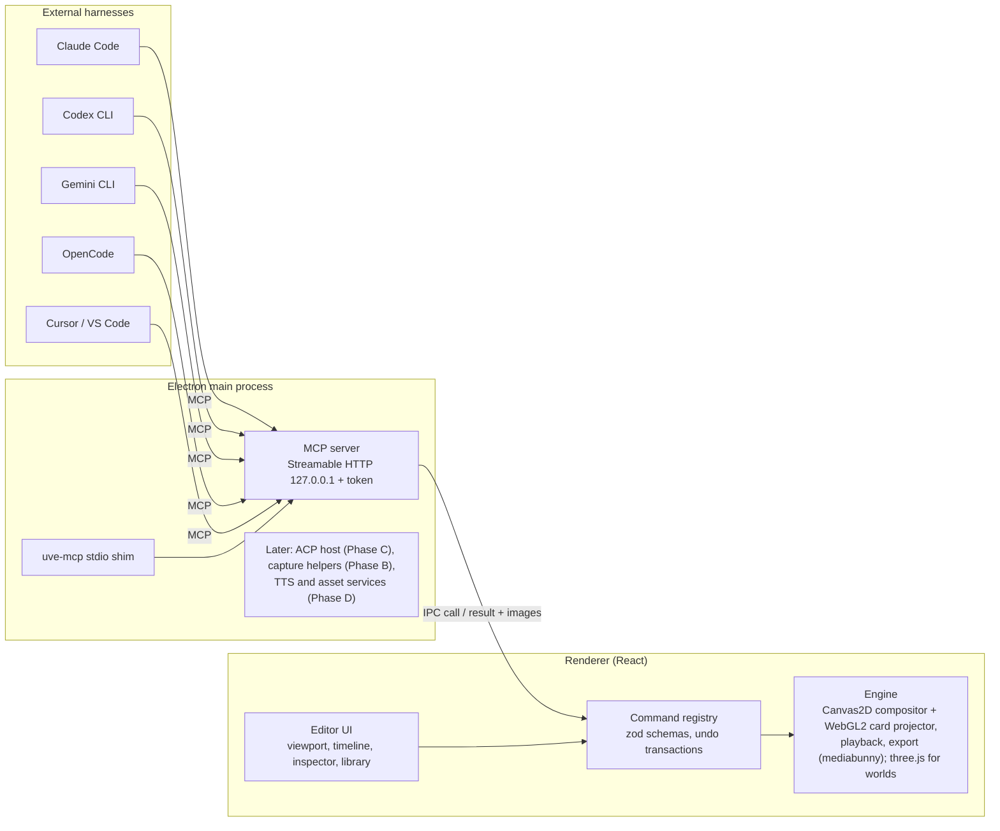

# Ultimate Video Editor: plan

Date: 2026-10-24 (revised the same day). Status: Phase A (editor foundation) in progress. A1 to A6b, A8, A9 and A10 (assets and the remaining gaps) are done; next is A7 (3D worlds). **Target: full AtomCut parity** — every AtomCut feature, robust and usable by hand; every AtomCut MCP tool working properly; agent-made videos at AtomCut's quality; and all of AtomCut's assets (see "The bar" in `docs/atomcut-parity.md`).

## Goal

The goal is a desktop video and motion editor that does these things:

- It works like AtomCut: a document-driven editor with a multi-track timeline, keyframes on every property, effects, kinetic text, and seamless 2D↔3D.
- It records the screen like OpenScreen, with automatic editing such as zoom on clicks and cursor polish.
- It can be driven by any agent harness through MCP.
- It hosts an agent inside the app (OpenCode bundled).
- It makes voiceovers with Gemini TTS, using the user's free API key.
- It ships with a free asset library.

Everything also works by hand. See `docs/research/atomcut-inspiration.md` for the reference study.

## Order of work (the professor's guidance)

The AtomCut-like editor foundation comes first. Everything else builds on its document model and command API:

- Screen recording is another source of clips.
- Agents are another caller of the same commands.
- TTS and the asset library are sources of media.

OpenScreen's features and the in-app harness come after the foundation.

## Key decisions

1. **Foundation: a clean base built from proven open-source libraries, not a fork of an app.**
   - AtomCut's core is a document-driven, schema-first model where every property can be keyframed by path. Existing editors such as OpenScreen and OpenCut are built around other data models, so retrofitting one would cost more than building the core cleanly.
   - Stack: Electron + electron-vite + React + TypeScript, in a pnpm monorepo.
   - Libraries do the heavy lifting: three.js (rendering), mediabunny (decode, encode, mux), zod (schemas), immer (patches and undo), zustand (state), and React UI libraries (Radix/shadcn, react-resizable-panels).
2. **Renderer (revised in A3 after studying AtomCut's renderer with REA).**
   - Flat comps are drawn with Canvas2D, which Chromium runs on the GPU. It gives exact text, shapes, images and video.
   - Layers with depth or tilt (`z`, `rotationX`, `rotationY`) are drawn by a small WebGL2 card projector in true perspective, then composited in their place, so stacking order holds.
   - Every flat comp is seen through a front camera (50 mm lens on a 36 mm sensor) placed so that depth 0 is pixel-exact.
   - three.js arrives with 3D worlds (A7). A world's default camera matches the front camera, so moving layers "into 3D" changes no pixels until a camera moves (see the research notes).
   - Pixel effects (blur, grade, key) will be WebGL2 passes.
   - **Media (decided in A4).** Files stay where they are on disk, and a project stores their paths. AtomCut copies every file into browser storage; on a desktop with limited disk we do not.
     - The renderer loads files through a privileged `uve-media://` scheme. The main process serves only paths the user granted (a drop or the open dialog), with HTTP ranges and CORS headers.
     - The preview plays each video or audio layer with its own hidden media element, kept in step with the comp clock: it seeks when far off and nudges its speed when close.
     - mediabunny (MPL-2.0, used unmodified) reads metadata and makes thumbnails at import, and decodes and encodes exports.
   - **Export (decided in A5).** An export is drawn by the same compositor as the preview, on an exact frame clock (frame n at n / fps).
     - Video frames come from mediabunny (`ExportSources`), which decodes each layer's video forward in order, rather than from the preview's media elements. Rotation metadata is applied as in the preview.
     - The sound is mixed in TypeScript by the engine (`mixLayer`), one second at a time and just ahead of that second's frames, so memory stays flat and the file is interleaved. A windowed-sinc resampler handles speed and sample-rate changes. Speed changes pitch, as on tape, and volume goes up to 400 %; the mix is clipped at full scale.
     - mediabunny encodes H.264 and AAC and writes the MP4 through a stream straight into the file chosen in the save dialog, with the index reserved at the start (fast start).
     - The first AAC packet decodes imperfectly, so each export starts with one frame of silence before 0 s that an edit list trims, as ffmpeg does with its priming. Source sound is decoded from 0.2 s early for the same reason.
     - Media frames are looked up 1 ms past the exact source time, in the preview and in exports, so rounded timestamps cannot pick the frame before.
     - The preview follows the export: layers at a changed speed play with pitch following speed, and every element's sound goes through a Web Audio gain, so volumes above 100 % are heard.
3. **State and undo.**
   - The document model is defined as zod v4 schemas. JSON Schema is generated from them for agent tools and for `describe`.
   - State lives in zustand. Every change is a command that edits an immer draft.
   - The resulting patches form transactions, so one user gesture, or one agent request, is one undo step.
4. **Agent listening.**
   - The command registry is exposed by an MCP server in the Electron main process: Streamable HTTP on `127.0.0.1`, with a bearer token.
   - A small `uve-mcp` stdio shim serves clients that only speak stdio.
   - Tools can return rendered frames as images, so agents can check their work.
   - Skill docs ship as MCP resources from the same build.
   - A "Connect your agent" panel gives setup commands or config for Claude Code, Codex CLI, Gemini CLI, OpenCode, Cursor and VS Code.
5. **OpenScreen (MIT) is reused in Phase B.** We port its native capture helpers (Windows Graphics Capture with system audio, mic and webcam; ScreenCaptureKit on macOS), cursor telemetry and auto-zoom logic, keeping its MIT notice.
6. **The in-app agent comes in Phase C.**
   - An Agent Client Protocol (ACP) client hosts OpenCode (`opencode acp`, bundled) and Gemini CLI (`gemini --acp`). Claude Code and Codex need ACP adapter packages.
   - The editor injects its own MCP server into each agent session.
   - Fallback: an embedded terminal (xterm.js + node-pty).
7. **TTS comes in Phase D.**
   - The app calls the Gemini REST API with the user's key, stored with Electron `safeStorage`.
   - It reads `models.list`, keeps TTS-capable models, prefers the newest stable one, and falls back across models when a free-tier 429 arrives.
   - Audio comes back as PCM 24 kHz mono and is wrapped as WAV.
8. **Assets come in Phase D.**
   - Provider plugins: Openverse, Iconify, Fontsource / Google Fonts and Poly Haven (no key), then Pexels, Pixabay and Freesound (free key).
   - A bundled starter pack that contains only CC0 content.
   - License metadata is kept on every asset, and export produces an automatic attribution list.
9. **Other open-source editors we checked.**
   - [Elah](https://github.com/elahlabs/elah) (reviewed 2026-10-24) is a browser video engine: timeline, WebGL2 renderer, media pipeline, MP4 export and React bindings. Its licence is Apache-2.0, not MIT, so any code we port must keep its LICENSE and NOTICE.
   - It is a separate engine with its own data model, and it has no asset library. We do not adopt it. Its export design notes were read for A5; no code was taken.
10. **Licenses.**
   - Our code is MIT.
   - No GPL or AGPL libraries in the app core. If one is ever needed, it runs as a separate process.
   - Background-removal models must have permissive weights.

## Architecture

## Repository layout

- `apps/desktop`: the Electron app (main, preload, renderer UI).
- `packages/core`: document model (zod), property paths, commands, transactions and undo.
- `packages/engine`: the compositor (Canvas2D plus WebGL2 projector), front camera, layer evaluation, export.
- `packages/mcp`: the MCP server (Streamable HTTP) and the `uve-mcp` stdio shim.
- `skill/`: the agent skill docs, served as MCP resources.
- Later: `packages/recorder`, `packages/agent-host`, `packages/tts`, `packages/assets`.

## Roadmap

Each step ends with a runnable app, passing tests and updated docs. Steps are small so a usage-limit pause loses at most one step.

### Phase A: editor foundation (AtomCut-like, agent-ready)

- **A1 – Scaffold. (Done 2026-10-24.)**
  - The pnpm monorepo: Electron + electron-vite + React + TypeScript + Tailwind.
  - An editor shell with a top bar, library panel, viewport, inspector and timeline, in resizable panels.
  - Done when `pnpm dev` opens the window and `pnpm build` and `pnpm test` pass.
- **A2 – Core model and command API. (Done 2026-10-24; see `docs/core-api.md`.)**
  - zod schemas: project, comp, layer kinds, transform, keyframe tracks, easing.
  - Property paths, a command registry with validated inputs, transactions from immer patches, undo/redo, and `describe` for any type.
  - Done when unit tests cover commands, paths and undo.
- **A3 – Engine v0. (Done 2026-10-24.)**
  - The compositor. A flat comp drawn through a 1:1 perspective camera.
  - Text, shape, image and video layers. Transforms including `z`, `rotationX` and `rotationY`.
  - Keyframe interpolation with easing, and a playback clock.
  - Done when a demo project animates in the viewport.
- **A4 – Timeline and inspector. (Done 2026-10-24.)**
  - Lanes and clips (move, trim, split), playhead, keyframes.
  - The inspector edits through commands.
  - Media import by drag and drop (mediabunny metadata, thumbnails).
  - Done when a 10-second video can be built by hand with working undo.
  - Delivered:
    - Import by dropping files on the library, the picture or a track, or with the Import dialog. Files are served by the `uve-media://` protocol.
    - Real video and image frames in the preview, with audio during playback.
    - Timeline drag (to another track, or to a new one above or below), trim, split (S), snapping (Alt turns it off), zoom (Ctrl+wheel) and frame steps (arrow keys).
    - An editable inspector with key diamonds, and comp settings when nothing is selected.
    - New commands: `media.list`, `media.remove`, `track.create`, `track.delete` and `keyframes.remove`.
- **A5 – Export. (Done 2026-10-24.)**
  - A frame-accurate offline render to MP4 (mediabunny, H.264 + AAC) with an audio mix.
  - Done when the exported file plays and matches the preview.
  - Delivered:
    - An Export button (and Ctrl+E) with a save dialog, a progress dialog (frames, size, time left), Cancel (the partial file is deleted), and Show in folder.
    - Exact frames: in a test comp with a 2× clip at 25 fps, a rotated phone clip, a 3D card, keyed text and a keyed shape, each sampled preview frame matched its own export frame (about 29–30 dB) far better than its neighbours (17–21 dB).
    - The audio mix: speed (pitch follows speed), volume above 100 % and volume keys, mute, and 2 ms fades at layer edges except where a split clip carries on. Measured in the file: tone levels and frequencies as expected, cut points within a millisecond, and no dip at a split.
    - Missing media is reported before rendering starts. A 40 s 720p export took 15 s, with flat memory.
- **A5b – AtomCut-style editor shell. (Done 2026-10-24.)**
  - Why: the A1 shell worked but looked nothing like AtomCut. The live AtomCut 4.17.0 editor was studied with REA (screenshot and accessibility tree) and measured over CDP. See "Editor shell and visual design" in the research notes.
  - Delivered:
    - AtomCut's dark theme tokens: near-black stage, panel `#100c11`, brand `#ff4e6a`, 12 px radius and 6 px gaps. Inter, with JetBrains Mono for timecodes.
    - Floating panels. A left rail with Library, Media and Layers tabs plus Undo and Redo. A right rail with Export and an Inspector toggle. The old top bar is gone.
    - The Library has search, card sections (Basics, Templates) and eight entrance animations that key the selected layer.
    - The viewport has:
      - a glass tool palette: Move drags layers live as one undo step, Hand pans, and Text, Rectangle and Ellipse place a layer at the click;
      - a zoom pill (Fit, presets, plus and minus), Ctrl+wheel zoom around the pointer and wheel pan;
      - the artboard label above the comp.
    - The timeline has an AtomCut-style transport: a round play button, a brand-coloured timecode, an editable duration, split, delete, a snapping toggle, "+ Track" and a zoom slider. Track headers carry eye, mute and lock toggles, and the ruler is mono.
    - New model fields and commands: track `hidden`, `muted` and `locked` with `track.update` (hidden tracks are not drawn, picked or exported; muted ones are not heard; locked ones cannot be dragged by hand), and `project.update` to rename the project.
  - Shown only when real: AtomCut's Plugins, Agents and Scripts tabs, extra tools, the mixer and the Keyframes, Curves, Color and Nodes tabs are left out until their features exist.
- **A5c – Timeline views, inspector and preset library. (Done 2026-10-24.)**
  - Research: the live AtomCut 4.17.0 views, captured with REA (Keyframes, Curves, Color, Nodes, mixer, the full transport, and the inspector with a layer selected). AtomCut's preset catalogs were extracted as data into `apps/desktop/src/renderer/src/library/atomcut-catalog.json`: 103 text looks, 44 animations and 23 transitions. The owner reports permission for AtomCut's presets and assets.
  - Delivered:
    - **Bottom tabs:** Timeline, Keyframes, Curves | Color, Nodes.
      - **Keyframes** is a dope sheet: a grouped property tree with colour dots, and diamond keys you drag along time (snapped to frames, one undo step). Group keys move their children. Easing glyphs sit between keys. Delete removes the picked key.
      - **Curves** is a graph editor: normalised curves per property with eye toggles, keys you drag in time and value, and an Ease menu for the picked key.
      - **Color** is an honest empty state; grading comes later.
      - **Nodes** is a read-only node graph of the selected layer, live at the playhead, scaled to fit.
    - **Mixer:** a master level meter fed by an analyser on the preview's audio bus.
    - **Transport:** Record keyframes (every edit keys at the playhead; the first key goes through `keyframes.set`) and Loop.
    - **Inspector:**
      - a header with the layer name and Delete;
      - collapsible sections;
      - Transform in AtomCut's rows: Position X/Y, linked Scale, Rotate, Depth, Tilt X/Y, Pivot, Opacity;
      - axis letters you drag to scrub, and key diamonds at the row end (a section diamond keys all).
      - The right-rail tab reads Design or Project.
    - **Library:**
      - a category row: Everything, Text looks, Animations, Transitions, Sounds;
      - all 103 text looks, previewed in their own Google Font, added as a styled text layer with their entrance;
      - all 44 animations, applied as whole-layer keyframe versions written by us;
      - 23 transitions and 6 typing-sound packs, listed (sounds preview with our own Web Audio synthesis). Applying them comes with A9.
    - Clips show a second mono line: the kind and how many properties are animated.
- **A6 – Agent listening. (Done 2026-10-24.)**
  - The MCP server over the command registry (Streamable HTTP on 127.0.0.1 with a token, in the Electron main process), plus a stdio shim.
  - Every existing command becomes a tool, with AtomCut's tool names (`layer_set`, `keyframes_set`, `api_batch`, and so on).
  - Done when Claude Code builds a short title animation through MCP.
  - Research: `@atomcut/mcp` 3.6.0 (MIT: `src/cli.mjs`, `src/protocol.ts` and its bundled skill docs), AtomCut's tool schemas from its registered MCP server, and the live 4.17.0 Agents tab and "Use your agent app" dialog over CDP. See "The agent bridge" in the research notes.
  - Delivered:
    - **`packages/mcp`:** our own small Streamable HTTP server (spec 2025-06-18; JSON replies, no event stream, so GET answers 405). Bearer token compared in constant time, loopback Host and Origin checks against DNS rebinding, sessions with `Mcp-Session-Id`, batches, an 8 MB body limit. The `uve-mcp` stdio shim (`bin/uve-mcp.mjs`, no dependencies) relays to it, re-opens the session when the editor restarts, answers `uve_status` while the editor is closed, then announces the real tool list, and resolves a relative `localPath` against the agent's folder.
    - **Main process (`main/agent.ts`):** port 7428 (or `UVE_MCP_PORT`; a busy port falls back to a free one). The token (kept across launches) and URL go to `~/.uve/mcp.json`; the shim is copied to the user-data folder. It answers `uve_status` and `report_issue` (saved to `agent-reports.jsonl` in the user-data folder, never sent anywhere), grants the file for `media_import`, serves the skill docs, and relays every other call to the renderer over IPC. A reload or crash of the window fails the calls in flight with a clear message.
    - **Renderer (`renderer/src/agent/`):** every registry command is a tool. `view_render` (glance 384 px, look 768 px, inspect 1280 px, `layers` crops to their bounds) and `view_frames` (a labelled contact sheet) draw through the export's `ExportSources`, so they show exactly what the export holds. `history_undo` undoes only the calling agent's newest step. `media_import` probes, registers and optionally places a file. New desktop commands: `catalog.list` and `catalog.get` (text templates with a ready `layerCreate` input, animations, transitions, easings), `session.set` (open comp, playhead, selection), `app.console` (recent warnings and errors). `doc_overview` also returns where the user is.
    - **Undo per agent turn:** `session.call` takes a `group`; an agent's calls within 45 s of each other join one undo step named "Agent · <app>", and an edit by hand in between starts a new one.
    - **Strict inputs:** every command input rejects unknown fields (before, `layer.create` silently dropped a misplaced `fill`).
    - **Agents rail tab:** the server line, connected agent apps (sessions, calls, last activity), an example request, and each tool call with its result and time. **Connect your agent** is modelled on AtomCut's dialog: setup for Claude Code, Codex, Gemini CLI, OpenCode, Cursor, VS Code, Claude Desktop and any other app, with the token hidden until shown, plus the URL, token and stdio command to copy.
    - **Skill docs** (`skill/SKILL.md`, `references/api.md`, `references/review.md`), written for our tools and served as `uve://skill/…` resources.
    - **Checked:** a headless Claude Code session (Sonnet, MCP tools only) read the skill, built a 5-second title card with a staggered entrance in two batches, checked it with `view_frames` and `view_render`, and reported, in 10 turns and 28 s. Its edits were one undo step, "Agent · claude-code".
  - Not yet: AtomCut's input shapes differ from ours in places (for example `keyframes_set` takes `property` and `{at, value, easing}` there, `path` and `{t, v, ease}` here). Agents learn ours from the schema and errors; accepting both is a parity follow-up.
- **A6b – Foundation hardening and the quality bar. (Done 2026-10-25.)**
  - Why: at the end of A6 the foundation is sound but much thinner than AtomCut's (35 tools against about 190, and section 0 of `docs/atomcut-parity.md` lists the gaps). The owner's bar: every AtomCut feature robust, every MCP tool working properly, agent videos at AtomCut's quality, and all the assets. The foundation is fixed before new tool groups are added.
  - Research first with REA (clean room; preset data and assets allowed): AtomCut's tool schemas, the skill references, chunk 459 for command behaviour, and the live app over CDP.
  - Steps, each by hand and as a command, tested and checked in the running app:
    1. **Project save and open. (Done 2026-10-24.)** A project file (the document as JSON plus a manifest; media stay where they are, by path), Ctrl+S, Ctrl+O, recent projects, and a warning on unsaved changes. Commands and tools for agents.
    2. **Export as a tool (Done 2026-10-25)** (`export_video {compId, path?}`), so an agent can finish a video, with progress and a clear result.
    3. **AtomCut's input shapes (Done 2026-10-25)** accepted next to ours (`keyframes_set` `property` and `{at, value, easing}`, `layer_set` `ids` and `mode`, `frameId` for comps), and `keyframes_inspect`.
    4. **Asset inventory (Done 2026-10-25):** capture the live Library's network traffic over CDP and list every asset (fonts, sounds, templates, characters, stickers, stock) in section 9 of the parity doc, with what porting each needs. Cache the 68 Google Fonts on disk.
    5. **Quality benchmark (Done 2026-10-25; see `docs/benchmarks/results.md`):** turn AtomCut's skill recipes (title card, lower third, kinetic type, lyric captions, reel, promo, logo reveal) into briefs in `docs/benchmarks/`. Run each through Claude Code over MCP, render contact sheets, and record what is missing to reach AtomCut's quality. These gaps order the work in A8 and A9.
  - Done when a project survives a restart, an agent can go from a brief to an exported MP4 with no human step, AtomCut's input shapes work, the asset inventory is complete, and the benchmark results are recorded.
- **Order after A6b:** A8 (layers, text, pages) and A9 (motion system, effects, transitions) come before A7 (3D worlds), because the benchmark briefs depend on them.
  - The benchmark of 2026-10-25 (`docs/benchmarks/results.md`) ordered them. All seven briefs ended in an exported MP4 with no human step; what the agents had to fake or leave out, by how many briefs it cost: per-unit text animation (3), gradients and glow (3), the text box (2), sound (3), effects (3), transitions (2), stroke trim, paths and masks (1), groups and auto layout (2), rich runs (1), captions (2), nesting and ripple edits (1).
  - **A8 order:** the text box (anchoring, wrap width, auto size), paints (gradients, several fills and strokes, stroke trim), groups with auto layout, path layers and masks, rich text runs, then nesting and ripple edits.
  - **A9 order:** the per-unit animator with the 44 presets, the effect stack (blur, glow, shadow, shine, motion blur), the 23 transitions, the sounds stack with the typing packs, captions with states, and the CC0 sound library (4,555 sounds, pulled forward from phase D).
  - Re-run the benchmark at the end of A8 and of A9.
- **A7 – 3D worlds.** (Done 2026-10-28.)
  - Move into a world, camera layers with cuts, lights, extrude, materials.
  - Done when a 2D title moves into a world and the camera flies around it with no visual jump.
  - Chunks A7b to A7n are planned in `docs/handoff-archive.md` ("Plan of A7"). A7a done 2026-10-26: research ("3D worlds" in the research notes) and the plan, with no code. A7b done 2026-10-26: the world document (`Comp.world` with render and fog, `scaleZ`, camera, light and controller layers only in worlds, project format 8), the pure world math in `core/src/world.ts` (picture planes, cameras, the live camera, look-at) and the commands `world_create` and `world_inspect`. A7c done 2026-10-26: `world_move_into` (2D layers or a whole frame into a nested world with no visual jump, proved to 1e-6 px), `world_add` (cameras, lights, controllers, text), `world_camera` (report, activate, a camera at the default pose), keyable `scaleZ`, lens and light paths, and `layer_create` of the new kinds in a world. A7d done 2026-10-26: the world renderer (three.js r186 behind a dynamic import; moving into a world changes no pixel away from edges). A7e done 2026-10-27: by hand (inspector World, 3D transform, Camera, Light and Controller sections, the "3D" button, menus, lane icons and the live-camera mark, dragging in a world). A7g done 2026-10-27 in core and engine: lights, environments, shadows, tone mapping, fog and the 17 materials (`world_material`, `world_look`). A7g2 done 2026-10-27: the inspector's Material section (17 presets, None, keyable roughness, metalness, emission and transmission) and the World section's look (tone mapping, exposure, shadows, shadow quality, mist). A7f done 2026-10-27: the 3D motion path through the live camera (read only), skill 0.15.0 ("3D worlds"), the parity rows per world tool, and benchmark brief 09 (a title in space: built in a world, exported, $0.82). A7h done 2026-10-27: meshes (the 13 primitives with AtomCut's params, keyable `geometry.<param>`, shading, the starter cube, `world_add {kind: mesh}`, `catalog_list primitives`, the inspector Mesh section; project format 9; skill 0.15.1). A7i done 2026-10-28: thickness (`world_extrude`: text by its glyph outlines through opentype.js, shapes and closed paths by their outlines with holes, images by an alpha trace, video and nested frames as a slab; keyable depth and bevel; sides in the fill or text colour darkened; the inspector Thickness section; skill 0.15.2). A7j done 2026-10-28: the look, part 2 (`world_look` bloom from bright areas or emission with a finish that lets a transparent world glow over 2D, ambient occlusion, the shadow, solid and mirror floors, depth of field per camera with `focusOn` and keyable focus and f-stop, and motion blur in worlds through the live camera's shutter; inspector World and Camera rows; skill 0.15.3). A7k done 2026-10-28: controllers and constraints (`world_track`: look at, follow with or without its turns, child of with a stored inverse so the layer stays put, influence; solved in core `worldObjects`, so the render, `world_inspect`, motion paths, focus and world motion blur follow; the inspector Track section; skill 0.15.4; AtomCut's orbit recipe and a camera on a controller checked over MCP). A7l done 2026-10-28: models (`world_import_model` for glb, gltf with its sibling files, obj, stl and ply from a path or an https url; a `model` media asset and a mesh with `geometry {type: asset}`; AtomCut's sizing; Draco and meshopt; the file's or our materials (`material.source`); the file's animation clips on the layer's time, frame-exact in export; drop or Import into an open world; the inspector Model section; project format 11; skill 0.15.5). A7m done 2026-10-28: the orbit view (a free view of a world in the viewport, toggled by the viewport pill or the 0 key: orbit, pan and zoom with AtomCut's buttons, wheel and numpad keys; Solid, Material preview and Rendered shading; a ground grid; camera, light and controller gizmos as lines; click to select meshes, models and pictures through the orbit camera; the 3D motion paths of the selected layers; editor state only, so renders and exports are unchanged). A7n done 2026-10-28: closing A7 (skill 0.16.0 checked against the live tool schemas, with lights and review lines; the parity rows; benchmark briefs 10, a product turntable, and 11, a neon logo, both built in a world and exported with no help, $0.71 and $0.79). Fixed while running them: a GPU memory leak that hung world exports (a new three camera per frame kept a transmission render target each for glass), and the app now renders on the discrete GPU when there is one (`force_high_performance_gpu`; `UVE_LOW_POWER_GPU=1` opts out); a 6 s 1080p world with glass, a mirror floor, AO, bloom and motion blur exports in 10 s on the GTX 1650 and 67 s on the Intel UHD. Follow-ups (a lost context hangs an export, glass transmission, neon tone, flat fields on `layer.set`) are listed in `docs/HANDOFF.md`. Modifiers, sculpting, lattices, mesh editing, booleans, line art, faces, IK, physics in worlds and model export are phase E.
- **A8 – Layers, text and pages.** (Done 2026-10-25.) Steps, in the benchmark's order:
    1. **The text box (Done 2026-10-25).** AtomCut's three resizing modes on text layers: auto width (one line per paragraph), auto height (`maxWidth`: lines wrap between words) and a fixed box (`maxWidth` and `maxHeight`, with `verticalAlign` and `clipContent`). Both box sizes are keyframable (keying the width re-wraps). `style.align` gains `justify`. The pivot (`anchorX`, `anchorY`) is now a fraction of the layer's box like AtomCut's (0.5 the centre, 0 the left or top edge), so a text with `anchorX: 0` keeps its left edge as its words change; AtomCut's `anchor.x`, `anchor.y` and `anchor: [x, y]` work too. Project files are format 2; format 1 files have their pixel pivots converted when they open. `layer_create` takes `maxWidth` and `maxHeight`, and `layers_list` reports each layer's measured bounds. By hand: the inspector's Sizing section (Resizing, Box width and height with key diamonds, Vertical, Clip content), Pivot in percent, and a Justify button. Not yet: dragging the box edges in the viewport (it comes with transform handles).
    2. **Paints (Done 2026-10-25).** Shape and text layers have AtomCut's ordered `fills` and `strokes`: solid, linear, radial and angular paints (stops, start and end in the box, opacity, 16 blend modes), and strokes with alignment (centre, inside, outside), caps, joins, dashes and trim (draw-on). Every paint value is keyframable by AtomCut's paths (`fill.<id>`, `fill.<id>.stop.<stopId>.color`, `stroke.<id>.trim.end`…); `fill`, `strokeColor`, `strokeWidth`, `trimStart`, `trimEnd` and `trimOffset` name the first ones. `layer_create` takes `fill`, `stroke`, `fills` and `strokes`; `layer_patch` mints ids and drops the keys of removed paints. Project files are format 3 (a shape's old `fill`, `strokeColor` and `strokeWidth` become paints). By hand: the inspector's Fill and Stroke sections (type, colour or stops, gradient ends, opacity, eye, remove, add; width, align, ends, dash, trim). Not yet: media, pattern and variable paints, the stroke pipeline (taper, roughness and so on), trim on text, paints on media layers.
    3. **Groups with auto layout (Done 2026-10-25).** A `group` layer kind: lanes carry a `groupId` and a group's member lanes follow its own lane, as in AtomCut. The group moves, turns, scales and fades its members as one (a delta around a point of its box), its span is a window on them, and hidden or locked group lanes hide or lock them. Auto layout (row, column, wrap, grid; gap, line gap, padding, alignment, space between, hug or fixed size, min and max, top-left box, clip) is solved at render time by the engine; members may fill or opt out (`layoutItem`). With a layout the group's fills, strokes and `cornerRadius` draw the container, and a rectangle behind the others becomes it. Commands `layers.group`, `layers.ungroup`, `layout.set` (baking positions, and a container rectangle, when a layout or a moved group goes); `layer.create {groupId}`; delete, move, split and track.create know about groups. Commands that bake or infer measure through `Session.measure` (the engine's placements). By hand: Shift-click to select several, Ctrl+G and Ctrl+Shift+G (and the Layers panel buttons), nested lanes in the timeline and the Layers panel, and the inspector's Auto layout and "In <group>" sections. Not yet: mask and boolean modes (next step), reordering by dragging inside a layout.
    4. **Paths and masks (Done 2026-10-25).** A `path` layer kind from SVG path data (stored normalised as `geometry`, centred on the resting outline's box, `fillRule`), keyable `geometry` that morphs between paths with the same commands, polygon and star shapes (`pointCount`, keyable `innerRatio`), and group modes `union`, `mask`, `subtract`, `intersect` and `exclude` with `isStencil` cutters (the front-most member by default), drawn by compositing. Stroke trim draws on paths too. By hand: the Pen tool (P), the Path section (path data, fill rule), Polygon and Star in the shape type, the Group section's Mode, and Stencil on members. Not yet: editing path nodes by hand, text on a path, luma mattes, feather.
    5. **Rich text ranges (Done 2026-10-25).** Text layers have `ranges` (grapheme spans with a style: font family, size, weight, italic, colour, letter spacing, opacity, highlight) and `style.highlight` (a pill behind each line). `text.style` (match with occurrence, or start and end; `clear`), `text.set`, and text edits through `layer.patch` keep ranges on their words. Range colour, opacity and size are keyable (`range.<id>.…`), and AtomCut's `keyframes_set {range}` works for them. Layout cuts lines into styled fragments; a line is as tall as its largest font; export fonts include the ranges'. By hand: select characters in the Text field and set their colour, weight, size or pill (or Plain); a list of styled ranges with keyable colours; Highlight for the whole layer.
    6. **Duplicate, copy, restack, nesting and ripple edits (in progress).** Done so far: `layers.duplicate` (each copy on a new lane just in front of its source, in its group; a group with its members, their lanes following the copied group), `layers.copy` (into any comp at the front, lanes shared as in the source, `atMs`, AtomCut's `toFrameId`; members copied without their group go to the top level) and `layers.restack` (`front`, `back`, `{above}`, `{below}`; whole lanes move, a layer sharing a lane gets its own, the target's group is joined; audio stays out of groups). By hand: Ctrl+D, Ctrl+C and Ctrl+V (paste at the playhead into the open comp), Ctrl+Shift+] and Ctrl+Shift+[, and three buttons in the Layers tab. Nesting done: a `nested` layer kind (`sourceCompId`, `trimInMs`, `playback {speed, loop, loopLengthMs}`, `clipContent` auto/crop/spill, `volume`, `muted`) and embedded comps (`embedded` on the comp; they go when their layer is deleted); `layers.nest` (hugs the layers measured by the editor, or `fullFrame`), `layers.makeUnique`, `layer.create {kind: "comp" | "nested", sourceCompId | sourceFrameId}` (refuses loops), split and trim keep the inside in place. The engine builds a nested node from the source comp's scene at the layer's own clock (crisp, no raster), and `playedMedia` places the media inside in the outer time (`<nested>/<inner>#<pass>`) for the preview, export frames and the sound mix. Project files are format 4. By hand: Nest button, double-click or Open to enter, breadcrumb back, inspector Nested comp section. Ripple edits done: `timeline.close_gaps`, `timeline.compact` (level by level, runs of movable lanes, what covers what kept, empty lanes dropped) and `timeline.cut_ranges` (sync, lane, none; one undo step; media sources and nested trim-ins follow the cuts) in `core/src/commands/ripple.ts`; by hand Shift+Delete (ripple delete) and a Close gaps button. Next: re-run the benchmark. Not yet: Ctrl+X (cut), `reverse`, keys on a nested layer's speed and volume, components.
  - Duplicate and copy, groups, nesting (precomps), restacking.
  - `text_set` and `text_style` (rich runs).
  - Fonts: the 68 Google Fonts the looks use, cached on disk.
  - Frames and pages on a canvas.
  - Ripple edits: `timeline_close_gaps`, `timeline_compact`, `timeline_cut_ranges`.
- **A9 – Motion system.** (Done 2026-10-25; the end-of-A9 benchmark ran briefs 01 to 04, see `docs/benchmarks/results.md`.) The end-of-A8 benchmark run (2026-10-25, `docs/benchmarks/results.md`) confirmed the order: per-unit animation, sound, transitions, effects, captions.
  1. **The per-unit animator (Done 2026-10-25).** `animation.set` (AtomCut's `animation_set`, same input shape): the 44 presets as entrances and exits, on every visual layer as a whole (`animIn`, `animOut`) and on text per letter, word or line (`textIn`, `textOut`), with duration, stagger, delay, easing, jitter, scatter and the preset's knobs; an exit without its own pose plays the entrance backwards; swapping keeps the timing. `draw` draws shape and path outlines on, piece by piece (together, one by one or staggered; forward, backward or both ways; the fill kept, along or late; a pen for layers with no stroke). Poses (opacity, offset, scale, rotation, blur) are our own formulas (`core/src/animationPresets.ts`), timing in `core/src/animation.ts`; the engine draws each text unit at its pose (`content.ts`), and blurs whole layers and groups through an isolated composite (`renderer.ts`). Project files are format 5. By hand: the Animate tab in the right rail (Layer and Text animate in and out cards: preset, Per, Timing, Delay, Humanize, a unit timeline, knob bars, easing glyphs, preview and remove), Library ▸ Animations and text looks (with their entrance), clip bands and labels in the timeline; `layers_list` lists each layer's animations. Not yet: per-range animations, the typing cursor, `draw` on text.
  - The per-letter, word and line animator (`animation_set`): the 44 presets with units, stagger, easing and params, as in and out animations.
  2. **The effect stack (Done 2026-10-25).** `effects.add` and `effects.update` (AtomCut's names and input shapes), `effects` on every visual layer and `style.textEffects` on text (core `effects.ts`: AtomCut's card types, fields, ranges, defaults, labels and taglines as data), keyable at `lfx.<id>.<field>` and `tfx.<id>.<field>`, loose cards in `layer.create` and `layer.patch`, the `layer-effects` and `text-effects` catalogs. Engine `effects.ts`: 14 layer cards (drop shadow, inner shadow, glow, long shadow, layer blur, directional, zoom and spin blur, sharpen, adjust, vignette, stroke from distance fields, RGB split, shine on its own clock) run on a canvas the size of the layer and its reach (`renderer.ts` `drawWithEffects`, with a canvas origin), on leaves, groups and nested comps; 4 text effects (shadow, glow, extrude, echo) drawn per glyph at its pose. Text looks bring their effects. By hand: the Effects tab (cards with key diamond, settings, eye, bin, reorder; a searchable picker by family). Project files are format 6. Motion blur done too: `motionBlur` on comps (the master, on by default as in AtomCut) and layers (`enabled`, `override`), core `motionBlur.ts` (settings, AtomCut's 7 shutter presets, `shutterWindow`, `shutterSamples` with box, ease, trail and lead weighting), keys at `mblur.*`, `comp.update {motionBlur: {preset, …}}`; engine `motion.ts` `planMotion` (what moves while the shutter is open, scenes built once per moment, about one moment per 1.5 px of travel up to `maxSamples`) and `renderer.ts` `drawMoving` (velocity smear, or the node placed or redrawn at each moment, mixed by weight in pairs on the GPU: average, add, screen, max; strength mixes the sharp frame back); the viewport draws at most 6 moments while playing. By hand: Design ▸ Motion blur (switch, preset, shutter, phase with keys, quality Fast, Exact, Full, Use the comp's) and the comp's Motion blur section. The analog cards done too (engine `analog.ts`: a seeded clock with jitter and stutter, `animate` to hold one look; grain, value-noise fields with fractal, turbulence and ridged shapes and displacement, line and phosphor masks with roll, flicker, interlace and tube curvature, film damage with dust, scratches, hairs, flicker, gate weave and splices); the text looks now bring every card they use. The distortion cards done too (engine `distort.ts`: one bilinear remap on premultiplied pixels with optional colour fringing; bulge, travelling wave with anchor, twirl, lens distortion, goo with a slope-aware threshold edge, roughen edges moving only the outline, line boil with looped variants, shake and turn, glitch bands with shift, channel split, scramble and colour shift). Colour and stylize cards done too (engine `stylize.ts`: colour grade with lift, gamma and gain, gradient map, posterize with ordered dither, Fill & gradient, chroma key with spill, choke and feather, halftone in mono, duotone, colour and CMYK screens, pixelate with LED dots, bevel and emboss lit from distance-field slopes; `distance.ts` holds the distance fields). Light and material cards done too (engine `light.ts`: light rays from the bright parts grown about a centre with decay, a lens flare with glow, halo, streak and ghosts, lightning by midpoint displacement with branches, taper, glow and a sliding window, and liquid glass bending the backdrop (`EffectEnv.backdrop`, a copy of what is drawn under the region) through a rim profile, with dispersion, frost, tint, rim light, unevenness and ripples). 38 of AtomCut's 39 layer cards; `grade` (the node graph) waits for phase E. Not yet: Looks (saved stacks), the floating settings window with before and after, copy and paste of cards, audio effects. Not yet: Looks (saved stacks), the floating settings window with before/after, copy and paste of cards.
  3. **Transitions (Done 2026-10-25).** `transitions` on lanes (`aLayerId`, `bLayerId`, preset, duration, split, easing, params, colour; project format 6), core `transitions.ts` (the 23 presets: AtomCut's ids, labels, categories, default durations and easings and knobs, with our own pose formulas; windows, sides held past their spans, eased progress, lone heads and tails, colour dips on one side, audio gains), `transition.add` and `transition.remove` (`commands/transition.ts`; a split hands a tail to the right half, delete and lane moves prune). Engine: the scene builder poses both sides in a window (`pose` in `scene.ts`, `NodeTransition`), `renderer.ts` `drawTransition` draws a pair joined by a wipe (`transition.ts` `wipeMask`: linear, circle, clock, barn), a veil or a tear; `transitionEnvelope` crossfades the export's sound. By hand: Library ▸ Transitions on the selected layer, markers on the lanes with a remove button. Not yet: dragging a transition onto a cut, editing one's duration by hand, the preview's sound crossfade.
  4. **The sounds stack (Done 2026-10-25).** `sounds` on every layer (core `soundVoice.ts`: AtomCut's voice shape, `pack` or `custom {assetId, hitMs}`, volume, pitch, randomness, phase, trigger text, layer or transition, anchor, offset; project format 6), `sounds.ts` (`soundHits`, `compSoundHits`: each unit's start, middle or end, a whole-layer animation, or a transition's window; seeded timing, pitch and gain variation). Engine `soundSynth.ts` synthesises the six packs (band-passed noise clicks, swept tones; four takes each), `mixHits` adds hits to the export mix (custom sounds decoded whole, resampled by pitch); the preview schedules hits on Web Audio just ahead of the playhead. By hand: the right-rail Sound tab (slots per trigger and phase, Fires, voices with sound, preview, volume, pitch, variation, anchor, offset, mute, remove; Add sound), Library ▸ Sounds adds a pack to the selected layer, text looks bring their pack. Not yet: categories (buses), the leveler, ducking, sounds inside nested comps.
  5. **The CC0 sound library (Done 2026-10-25).** Main `soundLibrary.ts`: AtomCut's library at library.atomcut.net (index refreshed daily, manifests weekly, cached in user data `sound-library/`; blobs fetched once, checked against their SHA-256, granted for import; only ids and blob paths of the expected form are asked for). Renderer `library/soundLibrary.ts` and the desktop commands `sounds.list` (synth packs, the project's sounds, library sounds found by pack terms then by name, tags and blurb) and `sounds.use` (returns `{pack}` or `{custom: {assetId, hitMs}}`; library sounds are probed and added as media with a `credit` {source, license, attribution}, the hit at the loudest peak). By hand: Sound tab ▸ Find a sound (search, hear, use). Not yet: a browsable library panel with waveforms.
  6. **Captions with states (Done 2026-10-25).** `caption` on text layers (schema in `schema.ts`: cues of grapheme spans with layer times; unread, focus and read states, each a style (colour, opacity, weight, highlight) and a scale, AtomCut's defaults and its `{overlay: {props}}` shape accepted; motion with duration, easing and travel), core `caption.ts` (`captionLook`: each cue's state blended over the motion, styled spans laid over the layer's ranges by `overlayRanges`, cue scales as glyph poses by `scaleGlyphs`, the gliding pill), `caption.set` (`commands/caption.ts`: words matched in order, cues by index, or spread evenly; states and motion merged; text edits move the cues). Engine: `resolveLayer` applies it, `content.ts` draws the gliding pill between the cues' boxes. By hand: Design ▸ Caption (make, word timings, spread evenly, plain text, the three states' colour, opacity, scale and pill, Glide). Not yet: transcription (`media_transcribe`, phase E), per-state animations, the caption templates.
  - Text-look effects (shadow, glow, extrude, stroke, highlight box) and `template_apply`.
  - The effect stack (`effects_add`).
  - The 23 transitions (`transition_add`).
  - Typing-sound packs on text.
  - `keyframes_simplify`, and scripts (the **Scripts** rail tab).
- **A10 – Assets and the remaining A-phase gaps.** (Done 2026-10-26.) The owner's order: finish the benchmark, port the remaining assets, close the other A-phase gaps, then A7.
  1. **Text decoration, case and faux bold (Done 2026-10-26).** `style.decoration` (`none`, `underline`, `strikethrough`), `style.textCase` (`none`, `upper`, `lower`, `title`; display only, so graphemes keep their indices and word cues and styled ranges stay put) and `style.fauxBold` (0 to 0.25, a fraction of the size per edge), on a layer and on a styled range (`text.style`). Engine `content.ts`: `layoutText` shows each grapheme through its case (`displayed`, `startsWord`), spaces between decorated words become fragments so one bar runs through them, `decorationBar` draws the bar inked like the glyphs and under their poses, `inkText` thickens with a same-coloured outline. Inspector Style row (B, I, U, S) and Case row, also for the characters selected.
  2. **Templates (Done 2026-10-26).** The 103 text looks moved into core (`looks.ts`, `looks.json`) with the fields they had left out (pill, opacity, decoration, case, the caption `focus`). `template.apply {ids, templateId, keepSize}` (type, text effects, layer effects, entrance and typing sound replaced; words, ranges, position, box, alignment, line height and an exit kept; on a caption layer the spoken-word look too) and `layer.create {template}` (anything the caller gives wins). A look whose entrance moves the whole layer drops its text-only fields (they made some looks fail). The Library applies a look to the selected text (click) or adds one (plus).
  3. **The design system (Done 2026-10-26).** `skill/design-systems/default/DESIGN.md`, adapted from `@atomcut/mcp` (MIT): sizes from the comp short side, a type scale in px, colour roles, safe areas, motion and sound tokens with this editor easings and tools. Linked from the skill (version 0.10.0).
  4. **Fonts (Done 2026-10-26).** The Plugins rail tab and the Fonts window (`FontsWindow.tsx`): the Google catalogue (1,946 families; data in `library/google-fonts.json`, loaded as its own chunk), fonts installed in the project, and fonts on this computer (the Local Font Access API), previews in an isolated face (`previewFamily`, glyphs of the sample only), a windowed list, starred and recent. `Project.fonts` (`InstalledFontSchema`), `fonts.add`, `fonts.remove`, the host tool `font_install {localPath | url}` (main `fontFiles.ts` reads TTF, OTF, TTC, WOFF and WOFF2: family, weight, italic and the variable range), the desktop command `fonts.list`. Installed fonts load as `FontFace`s from their files when a project opens (`uve-media:` is allowed in the CSP `font-src`).
  5. **Icons (Done 2026-10-26).** Core `svgImport.ts` reads SVG markup (paths, primitives, transforms, colours, gradients, strokes, `use`, style attributes) into shapes with no DOM; `svg.place` places them as path layers (neighbours painted alike join, several are grouped, gradient ends become box fractions, `animIn: "draw"` per path) and `layer.create` takes `origin` (`{kind: "icon", id, license, author}` on every layer; `credits.ts` and `doc.overview.credits` list what is owed). Main `icons.ts`: the Iconify API (AtomCut mirror, then api.iconify.design), the 235 sets that are not copyleft or non-commercial, set listings, searches and icons kept on disk (offline for what was seen). Desktop commands `icons.list` and `icons.use`; the Icons window (sets by group, search, Line/Solid/Colour, a virtualized grid, colour, size, pen, Draw on and Out); the project Credits section.
  6. **Frames and pages (Done 2026-10-26).** `Project.pages`; comps have `mode` (`timeline` or `static`), `stillMs`, `overflow` (null auto, 0 crop, 1 show all; used where the frame is shown nested) and `pageId`. Helpers `findPage`, `pageOf`, `compsOnPage`, `compTimeFor` in `doc.ts`. Old project files open through schema defaults; the project format stays 6. Commands (AtomCut's names): `frame.create`, `frame.update`, `frame.duplicate` (an independent copy; owned nested comps are copied, transitions kept), `frame.delete` (the last frame stays; refused while other layers show it nested), `page.create`, `page.update`, `page.delete` (`moveTo`, `comps: keep | delete`; the last page stays). `comp.create` and `comp.update` are registry aliases of the frame commands. A flipbook `mode` is refused with a clear error. A static frame shows its still at any time, layers made in it span the frame, nested static frames hold, and it is silent; `view_render` maps any time to the still and `view_frames` returns one tile, both with `static: true`; `export_video` and Ctrl+E refuse it with a hint (PNG and JPG export of a still comes in step 8). Desktop: `PagesSection.tsx` in the Layers tab, inspector rows Mode, Still at, Overflow and Page, the viewport label `static · 0:04` and Play disabled on a static frame; `doc_overview` lists pages and modes. Checked in the running app over CDP and over MCP (all seven tools, undo).
  7. **`keyframes_simplify` and the work range (done 2026-10-26).** Core done 2026-10-26 (A10.7a): `keyframes.simplify` (`simplify.ts`: frame samples, greedy segments fitted with linear, hold, presets or a fitted cubic-bezier; x/y together; AtomCut's default tolerances; `id` or a comp's baked tracks); the work range as editor state (core `workRange.ts`, store `workRange`/`workRangeEnabled`, `session.set {workRange}`, `EditorView.workRange`). A10.7b done 2026-10-26: preview plays from the range's start and always loops inside it (AtomCut's behaviour); export writes the span (engine `renderPlan(comp, span)` with `firstFrame`/`startMs`, sound mixed from the span's start), `export_video` reports `startMs` and `workRange`, `view_frames` spreads over the range by default; the transport's Working range toggle with in and out buttons, `[` and `]` (AtomCut's default keys; an end set where it already is resets it), dimmed time outside the range and drag handles in the timeline; Simplify in the Keyframes and Curves tabs; skill 0.12.0. Fix found in the MCP check: a segment with one sample inside could not get a bezier (singular fit), which left a run of one-frame keys at an arc's end; it now fits both handles as one.
  8. **Export formats (done 2026-10-26).** AtomCut's panel ids `mp4`, `mov` (lossless master: PNG frames and PCM), `webm`, `gif`, `png-seq`, `audio` (WAV), plus stills (PNG as AtomCut; JPG and WebP), with its options (quality draft/high/master, bitrates, scale, frame rate, include audio, transparent, motion blur, range). Chunks in `docs/handoff-archive.md` ("Plan of A10.8"). A10.8a done 2026-10-26: research ("Export formats" in the research notes, incl. what mediabunny 1.61.3 and Electron 45 can encode here); `export/encode.ts` (`EncodeSpec`, `MP4_H264_AAC`), `renderComp` takes `encode` (MP4 by default, behaviour unchanged); `export/formats.ts` (`parseExportFormat`); `export_video {format}` writes MP4 and refuses the other ids with a hint. A10.8b done 2026-10-26: AtomCut's options on `export_video` and `exportCompTo` (`quality` draft/high/master as the bitrate formula, `videoBitrate`, `audioBitrate`, `scale`, `fps`, `includeAudio`, `motionBlur`, `range` full/span; pure helpers in `export/options.ts`, checked up front by `exportRenderOptions` in `export/job.ts`; engine `renderPlan(comp, span, {scale, fps})`); WebM (VP9, else VP8, + Opus; frame-exact) and audio only (16-bit 48 kHz WAV, no frame loop; a silent comp is refused with a hint); the file extension per format in `shared/export.ts` and main `export.ts`. Ctrl+E still writes MP4. A10.8c done 2026-10-26: the MOV master through our own QuickTime muxer (`export/mov.ts`, `MovWriter`: `ftyp qt  `, a 64-bit `mdat` streamed through the export write IPC and patched at the end, `moov` last with a `png ` video track (depth 24, or 32 with alpha) and a `sowt` 16-bit 48 kHz stereo track, `stts`, `stsc`, `stsz`, `co64`; tests parse the boxes back), PNG frames from `convertToBlob`, the same PCM as the WAV (`interleavePcm16` in `export/encode.ts`); `render.ts` writes through a sink per muxer (mediabunny or MOV); `transparent` on `export_video` and `ExportSettings` (MOV, and WebM through mediabunny `alpha: 'keep'`; engine `RenderOptions.transparent` clears instead of painting the background; refused with a hint for MP4 and audio). A10.8d done 2026-10-26: images. GIF through our own writer (`export/gif.ts`: median-cut palette per frame on a 5-bit histogram, exact colours when a frame has 256 or fewer, LZW, NETSCAPE loop forever, pixels under half alpha transparent with dispose 2, `gifDelays` in hundredths accumulated so the total is exact, at least 2; `EncodeSpec.maxFps` 50 caps the rate); PNG sequence as a folder `<name>-png-seq` with `frame-NN.png` from 0 padded to the frame count's digits (main `export:begin-folder-at` and `export:write-file`; an existing folder needs `overwrite`, which deletes only its `frame-N.png` files; a cancelled export removes what it wrote); stills `png`, `jpg`, `webp` (one frame at `atMs`, default the playhead, mapped as `view_render` maps it; `quality` gives JPG/WebP quality 0.8/0.92/1, 1 = lossless WebP). `EncodeSpec.audio` may be null; containers `gif`, `png-seq`, `still` each have a sink in `render.ts`. A static frame exports as a PNG by default (`defaultExportFormat`; also Ctrl+E) and refuses the other formats with a hint; `atMs` is refused for non-stills; `transparent` for all but MP4, audio and JPG. A10.8e done 2026-10-26: the export settings dialog before the save dialog (Ctrl+E, the rail's Export button, Main menu ▸ Export…), modelled on AtomCut 4.17.0's live panel (research notes, "The live export panel"): Image / Video, the format (audio only with sound; a static frame only as an image), Full / Working range (when a range is on; default the range), resolution and scale presets, frame rate with presets (GIF up to 50), Include sound, Transparent where the format keeps it, Motion blur, a still's time, Advanced quality and audio bitrate, and the summary line. Rules in `export/dialog.ts` (tests), component `components/ExportSetupDialog.tsx` (store `exportSetupOpen`, `openExportSetup`); every change runs `exportRenderOptions`, so refusals show in the dialog; `exportActiveComp(settings)`; main `export:begin-folder` (a save dialog naming the folder) for PNG sequences; `setDebugExportTarget` on `window.__uve` for checks. Skill 0.13.0 ("Exporting").
  9. **Motion paths (done 2026-10-26).** AtomCut's curved position keys: `arc` and `in`/`out` handles on `keyframes_set`, the `↷` mark in `keyframes_inspect`, the viewport overlay and its editing, and the Smooth button. Chunks A10.9b to A10.9g were planned in `docs/handoff-archive.md` ("Plan of A10.9"). A10.9a done 2026-10-26: research ("Motion paths" in the research notes) and the plan. A10.9b done 2026-10-26: the document shape and evaluation in core. A10.9c done 2026-10-26: `keyframes_set` takes `arc`, `in` and `out` on position, `keyframes_inspect` prints `↷(…)`, and the new `motion_edit` edits points and handles. A10.9d done 2026-10-26: the engine, motion blur and `view_*` follow the curve (checked in tests and in exports); the overlay geometry (`motionOverlay`, `hitMotion`) is in the engine. A10.9e done 2026-10-26: the viewport draws the motion path with AtomCut's look and hover (no drags yet), Main menu ▸ View ▸ Motion paths, and the Curves tab draws the true x(t) and y(t). A10.9f done 2026-10-26: editing the path by hand in the viewport (drag a point, a handle or a segment, Alt pulls out handles, double-click inserts or toggles smooth and corner, the point's context menu), all through `motion.edit`, one undo step per drag. A10.9f2 done 2026-10-26: `keyframes_smooth` (Catmull-Rom handles and monotone easings, so motion flows through its keys) and the Smooth button in the Keyframes and Curves tabs. A10.9g done 2026-10-26: the skill (0.14.0), the parity list, the README and this plan, and an agent run over MCP. Not done: 3D path display (waits for A7), the dashed leader during a drag, Shift axis lock on a point drag; AtomCut has no auto-orient or constant speed either.
- **Phase A is done (2026-10-28).** Next: Phase Q (below), set by the owner on 2026-10-29 ahead of phases B to E.
- The remaining groups in `docs/atomcut-parity.md` are spread over phases Q and B to E. They include grading and Nodes, rigs, poses, shape keys, physics, motion tracking, state machines, behaviours, expressions, links, switches, layout, flipbooks, generation, speech and audio tools.

### Phase Q: match AtomCut's video quality (done 2026-10-30, set 2026-10-29)

The owner watched the benchmark exports (copies in `~/Videos/UVE benchmarks/`) and judged them far from AtomCut's launch video, above all in sound. The rule now: **an agent-made video must look and sound as good as AtomCut's (and better than Remotion or HyperFrames) before anything else** (Sarvam, OpenCode, Easy mode, phase B). The thesis: the bottleneck is assets and craft, not rendering; the editor driven over MCP beats video-as-code because assets are first class and people can fix the result by hand.

What the launch video has that we lack (parity file, "Claims in AtomCut's launch video"): sound that feels finished (a mixer with categories, leveler, limiter and ducking), stickers and characters (image generation, `character_bringToLife`, rigs), real physics, and the agent's craft (AtomCut's skill 2.28 against our 0.16). 2D↔3D we have.

How AtomCut makes the model pick and place sounds (research notes, "Timing visuals to speech" and the Q1 research): every library sound carries tags, a usage blurb ("Lead the cut by 60 ms"), `hitMs` and `loudnessDb`; the skill's placement rules (whoosh peaks on the cut, impact on the contact frame, one family per piece, pops per word at 0.15 to 0.35); sounds live on the layer that causes them (the sounds stack); and the mix (categories, leveler, limiter, ducking) keeps careless gains from blasting. We have the library (4,555 CC0 sounds) and the sounds stack; not the mix, not the push in the skill.

Chunks, one chat each (plans per group are written in `docs/HANDOFF.md` as each starts):
1. **Q1 sound research (no code):** AtomCut's typing synthesis against ours (REA on the 4.9.0 chunks for the parameters as data; listen side by side), the mixer (sound categories, leveler, limiter, ducking: `sound_category`, `soundBus`, `soundMix`) from the 4.9.0 code and the live 4.17.0 app, and how 4.17.0 searches the library. Write the findings and the plan of Q2 to Q4. **Done 2026-10-29:** findings in the research notes ("Sound that feels finished"), plan of Q2 to Q4 in `docs/HANDOFF.md` ▸ "Plan of Phase Q (sound)".
2. **Q2 the mix:** categories (buses), routing, the leveler, the limiter and look-ahead ducking, in preview and export alike; the Sound tab's Mix. One chat, sub-steps in order: Q2a model and commands (format 12), Q2b engine and export mix, Q2c preview and the Sound tab's Mix. **Done 2026-10-29** (details in `docs/HISTORY.md`).
3. **Q3 sounds:** a local mirror of the whole CC0 library (no dependency on AtomCut's server). **Mirror taken 2026-10-29:** `~/uve-assets/atomcut-sound-library/` (the server's layout: `index.json`, `packs/<id>.json`, `blobs/<sha256>.<ext>`; `sounds.json` lists all 4,555 sounds flat with pack, tags, blurb, `hitMs`, `durationMs`, `loudnessDb`, licence; `mirror-sounds.mjs` re-runs it), 96 MB, all CC0-1.0, every checksum checked; each file is also hard-linked into the app's cache (user data `sound-library/blobs/`), so the editor already finds every sound offline. All 4,555 have tags, `hitMs` and loudness; only AtomCut's own 38 have usage blurbs, so Q3 writes blurbs for the sounds motion work uses most. **Done 2026-10-29:** the app reads the mirror first; AtomCut's search rule; AtomCut's six typing packs as data at their own levels with AtomCut's randomness; a recorded `keys` pack; 102 usage notes (details in `docs/HISTORY.md`).
4. **Q4 the sound pass in the skill:** sound becomes a required step of the loop and a review-checklist line; re-run briefs 01, 03 and 06 and listen. **Done 2026-10-29:** skill 0.17.0 (a Sound step, "The mix"), a master loudness match (−14 LUFS, format 14), beds and voice lines for the briefs; the three re-runs land at −15.2 to −14.1 LUFS, ≤ −1.3 dBTP, music ducked 10 dB under the voice (details in `docs/HISTORY.md`, `docs/benchmarks/results.md`).
5. **Q5 stickers and images:** (owner, 2026-10-29: no paid image APIs, and in the end no generated sheets either: free libraries instead) a sticker library, a flat-background key baked to alpha (`media_remove_background` for flat grounds). **Done 2026-10-29:** about 3,300 stickers from Fluent Emoji (MIT, 3D and flat), Open Peeps and Open Doodles (CC0) in `~/uve-assets`, searched like sounds; `stickers_list`, `stickers_use`, Library ▸ Stickers (click or drag); `media_remove_background` (our colour keyer, no AI model); skill 0.18.0 (details in `docs/HISTORY.md`). The sheet cutter is parked with the sheet prompts (`~/uve-assets/sticker-sheets/`).
6. **Q6 physics** (research, plan, chunks). **Done 2026-10-29:** planck.js (MIT) runs a deterministic simulation from the document (no baking; `physics_bake` on request): bodies on their outlines (pictures on traced silhouettes), forces, joints, floor and walls, by hand and as `physics_*` tools; skill 0.19.0; brief 13 works (details in `docs/HISTORY.md`). Worlds and rigs deferred. **Q7 characters** (`character_detect`, `character_bringToLife`, rigs, poses, behaviours; research, plan, chunks). **Done 2026-10-29:** switches, rigs whose pieces ride bones (FK, two-bone IK, limits), a live behaviour stack (blink, breathe, sway, nod, glance, talk from a loudness envelope), `character_detect` and `character_bringToLife` (Open Peeps and flat Fluent faces come alive in one call), the Inspector Character sections and bones posed on the canvas; skill 0.20.0; pose sets, bending art and transcript lip sync deferred (details in `docs/HISTORY.md`). **Q8 scripts** (`script_run` over the registry). **Done 2026-10-29:** `script_run` over every command as `ac.*` in a QuickJS sandbox, one undo step, rolled back whole on failure, time limit or stop, deterministic; saved scripts with replace mode (format 17); `script_runs|logs|stop`; the Scripts tab; `character_bringToLife {dryRun}` returns its plan as a script; skill 0.21.0; background runs and `script_reify` deferred (details in `docs/HISTORY.md`).
7. **Q9 craft and proof:** the skill's storytelling, review and recipes rewritten in our words; the main benchmark becomes recreating AtomCut's launch video shot by shot, compared side by side, plus one brief made both in HyperFrames and here. **Done 2026-10-30:** skill 0.22.0 (storytelling, recipes as scripts, review); the launch film rebuilt by agents in four acts hits all 16 beats, voice 8.4 dB over the bed against AtomCut's 9.6; HyperFrames' 06 has richer graphics, ours a weaker voice-over-bed balance; scripts no longer stall in a hidden window (details in `docs/HISTORY.md`, `docs/benchmarks/results.md`). **Phase Q is complete.**
8. **Q10 sound choice, seamless 2D↔3D, one continuous film** (owner, after the Q9 film). **Done 2026-10-30:** search ranks by quality and notes (348), a sound vocabulary in the skill (0.23.0, `references/sound.md`), limiter takes at most 3 dB in the loudness match; sounds fire from nested comps and worlds; 2D→3D frame-exact (export text no longer LCD), recipe 11; "A long piece in parts" in one project (details in `docs/HISTORY.md`).

**S1 Sarvam done 2026-10-30:** voices, word times, translation and `comp_localize` by hand and as tools, Indic scripts render; brief 06 in Hindi and Tamil against Sarvam's Dubbing API and a hybrid (details in `docs/HISTORY.md`, `docs/benchmarks/results.md`). Next: OpenCode as the only harness inside the app, then Easy and Advanced modes, then phase B.

**O1 OpenCode done 2026-10-30:** OpenCode runs inside the app over ACP (`opencode acp`) with our MCP server and skill, in the Agents tab's chat (live messages, tool calls, questions, Stop, model and key), confined to video work; brief 01 made by it on Zen's free GLM. Claude Code and Codex stay outside, over MCP. Next: Easy and Advanced modes (M1), then phase B.

**M1 modes done 2026-10-30:** Easy (chat, preview, simple timeline, Export) and Advanced (every panel), one switch remembered across launches; the chat carries where the person is (comp, playhead, selection) and takes speech in any language through Sarvam. Next: phase B.

After phase Q: Sarvam (voice, timing from silences per scene take, localisation into Indian languages; the research notes have the timing findings; **an A/B test the owner judges by ear and eye:** our rebuild per language against Sarvam's Dubbing API on the same exported video, and a hybrid of the dubbed audio with our on-screen text and captions re-timed to it), OpenCode as the only harness inside the app (Claude Code and Codex keep driving over MCP from outside, to keep the owner's accounts safe), Easy and Advanced modes, then phase B.

### Later phases

- **Phase B – OpenScreen features.**
  - Port the recorder and its native capture helpers, cursor telemetry and auto-zoom.
  - Recordings become clips with editable zoom keyframes.
  - Background, padding, rounded corners and shadow become layer properties.
- **Phase C – Harness inside the app.**
  - The ACP host with OpenCode bundled, an agent chat panel, and the terminal fallback.
- **Phase D – Voice and library.**
  - Gemini TTS with automatic model choice.
  - Asset providers, the CC0 starter pack, background music with ducking, attributions.
- **Phase E – Motion polish.**
  - Effects stack, text animators with per-letter sounds, transitions, captions through local Whisper.
- **Later:** physics, character rigs, motion tracking, plugins.

## Working rules

- Clean room for AtomCut (see the research notes). Keep the MIT notices of anything we port.
- Watch disk use. About 11 GB is free on C:.
- Commits are made only when the project owner asks. The project owner is the only author; no AI attribution.
